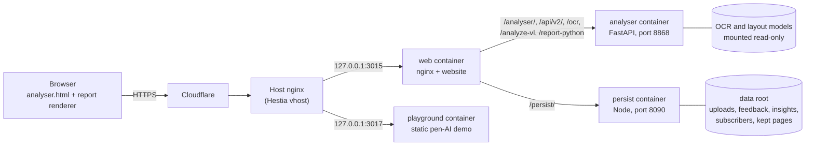
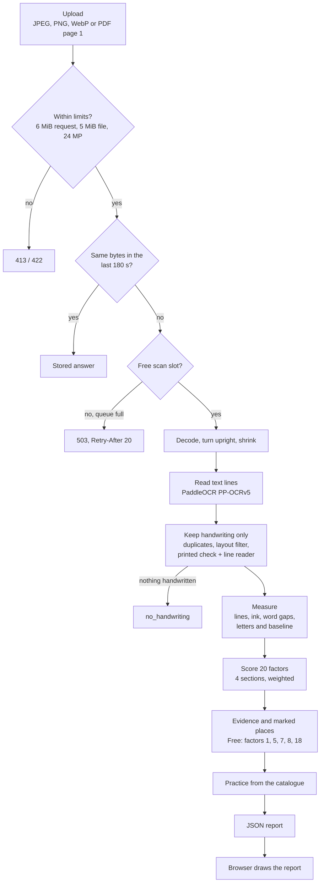

# System architecture: components, engines, languages and measured performance

The 20-factor analyser takes a photo of a handwritten page and returns twenty
scores, the places on the page behind them, and practice. This page is the
system view: what runs where, which engines read the page, which languages
and scripts are supported, and every performance figure that has been
measured, with its source. How one photo is read and scored, step by step,
is in [02-how-a-scan-works.md](02-how-a-scan-works.md); the plain-language guide
to the algorithms is [04-algorithms-plain-guide.md](04-algorithms-plain-guide.md).

A number appears here only when it comes from the code or a recorded
measurement. Where nothing has been measured, the page says so.

## 1. The system at a glance

| Part | What it does | Where |
|---|---|---|
| Browser app | Takes the photo, sends it, draws the report and practice sheet. Scoring is not done in the browser. | `frontend/src/app/app.js`, `frontend/src/engine/*.js`, `frontend/src/report/report-render.js`; bundled by `frontend/build_bundle.py` |
| Analyser server | Reads the page, scores the 20 factors, builds evidence and practice | `backend/analyser-ocr-server.py` (starts it), `backend/ppocr-server.py` (endpoints) |
| Website nginx | Routes, rate limits, body limits, caching | vahini-web `deploy/nginx.conf` |
| Persist service | Stores anonymous counts, feedback and pages a family chose to keep. Never the photo, unless the family ticks "Keep my pages". | vahini-web `services/persist-api/server.js` |
| Playground | Demonstration of the pen motion models | imu2text `playground/` |

### Analyser endpoints

| Path | Method | Purpose |
|---|---|---|
| `/api/v2/reports` | POST | The report, expanded or compact; Free gets the five free factors and their evidence |
| `/api/v2/me` | GET | Tier and what it allows |
| `/api/v2/catalog/{version}` | GET | Factor and practice catalogue, cached for a year |
| `/report-python` | POST | Older full-report endpoint |
| `/analyze-vl` | POST | Regions and evidence (Pro when tiers are enforced) |
| `/ocr` | POST | Text lines only |
| `/health`, `/ocr/health` | GET | Engine readiness, languages, scan capacity |
| `/analyser/*` | GET | The browser app (HTML never cached) |

Source: `ppocr-server.py:249-264, 434, 575-586, 882, 905, 920-953, 956`;
`analyser-ocr-server.py:31-84`.

## 2. What happens to one photo

Every step, with code references, is in
[02-how-a-scan-works.md](02-how-a-scan-works.md), sections 1 to 7.

## 3. Engines

The analyser has **four reading engines** and two ways of combining them.
**Production uses one: PaddleOCR.** The others are opt-in builds.

| Engine | Model | Role | In the production image? |
|---|---|---|---|
| **PaddleOCR (PP-OCRv5)** | Detector `PP-OCRv5_mobile_det`; English `PP-OCRv5_server_rec`, Telugu `te_PP-OCRv5_mobile_rec` | Finds every text line and reads it | **Yes, the default** (`config.py:58-71`) |
| TrOCR | `microsoft/trocr-base-handwritten` | Re-reads handwritten lines; never finds lines | Only when built with `VAHINI_WITH_TROCR=1` |
| Surya | Its default detection and recognition models | Indic scripts in `hybrid` mode | Only with `VAHINI_WITH_SURYA=1` |
| PaddleOCR-VL | About 0.9B parameters (code comment) | Whole-page vision-language reading; minutes per page on CPU | Opt-in |

| Mode | What it does |
|---|---|
| `hybrid` | PaddleOCR finds lines; TrOCR re-reads English handwriting, Surya re-reads Telugu, Hindi, Tamil, Kannada and Malayalam (`recognizer.py:52, 221-231`) |
| `auto` | Runs every installed engine and keeps the best-scoring reading (`recognizer.py:182-215`) |

The engine is chosen by setting (`VAHINI_OCR_BACKEND`), never by how busy
the server is, so the same photo is always read the same way. An unknown
value stops the server at start-up (`config.py:20, 60-69`).

Other models in the pipeline:

| Model | Role | Source |
|---|---|---|
| PP-DocLayout-M | Removes pictures, charts, stamps and seals before scoring | `layout_filter.py` |
| Print-or-handwriting line reader | Small trained network (about 19,000 weights, 8-bit, pure numpy) that stops very confidently read handwriting being refused as print | `print_hand.py`, `models/print_hand.json` |

Everything runs on CPU in production and stage (`VAHINI_OCR_GPU=0` in both
compose files). `gpu_detect.py` would use a GPU per engine when one is built
in and present.

The pen's motion models are separate, in the
[imu2text](https://github.com/vahinitech/imu2text) repository, and score
factors 13 to 16 only when pen data exists.

## 4. Languages and scripts

| Layer | Languages | Source |
|---|---|---|
| Reading (production) | English, Telugu | vahini-web `deploy/docker-compose.prod.yml` (`VAHINI_OCR_LANGS=en,te`) |
| Reading (stage) | English | `docker-compose.stage.yml` |
| Accepted by the server | en, te, hi, ta, kn, ml; anything not configured falls back to the configured list | `ppocr-server.py:16-17`, `recognizer.py:63-71` |
| Report text | English, Telugu (Telugu strings are a draft until a native speaker checks them) | `frontend/src/report/i18n.js:13`, `changelog.d/print-in-telugu.md` |
| Practice catalogue | English and Telugu exercises | `backend/practice_catalog.py:14-17` |
| Letter-zone measurement (factor 6) | Latin letters only; needs 12 or more | `zone_analysis.py:27-29, 190-196` |

The website's worksheet library also has pages for cursive, Hindi, Kannada,
Malayalam, Tamil and Telugu; the analyser scores English and Telugu.

## 5. The 20 factors

Four sections, weighted 0.30, 0.30, 0.20 and 0.20. A photo measures no
motion, so Dynamics gets no weight on a photo and the others are rescaled
(`scoring.py:140-163, 900-916`).

| # | Factor | Section | Tier | Needs the pen | Needs text read |
|---|---|---|---|---|---|
| 1 | Letter Formation Accuracy | Structure | Free | | yes |
| 2 | Stroke Order Consistency | Structure | Pro | | yes |
| 3 | Loop Closure | Structure | Pro | | yes |
| 4 | Line Quality (Smoothness) | Structure | Pro | | |
| 5 | Size Consistency | Structure | Free | | |
| 6 | Ascender / Descender Control | Structure | Pro | | yes, unless zone-measured |
| 7 | Baseline Alignment | Spatial | Free | | yes |
| 8 | Word Spacing | Spatial | Free | | yes, and 3 or more gaps |
| 9 | Letter Spacing | Spatial | Pro | | yes |
| 10 | Margin Discipline | Spatial | Pro | | |
| 11 | Line Straightness | Spatial | Pro | | yes |
| 12 | Vertical Alignment | Spatial | Pro | | yes |
| 13 | Speed Consistency | Dynamics | Pro | yes | |
| 14 | Pressure Consistency | Dynamics | Pro | yes | |
| 15 | Stroke Continuity | Dynamics | Pro | yes | |
| 16 | Pen Lift Frequency | Dynamics | Pro | yes | |
| 17 | Slant Consistency | Style | Pro | | yes |
| 18 | Legibility Score | Style | Free | | yes |
| 19 | Character Distinction | Style | Pro | | yes |
| 20 | Overall Neatness | Style | Pro | | yes |

Names: `scoring.py:167-196`. Tiers: `entitlements.py:14, 172-180`. Text
needed: `_NEEDS_RECOGNITION`, `scoring.py:652-654`. A factor that cannot be
measured says "Not measured" and is left out of every average.

## 6. Deployment and capacity

| Container | Production | Stage | Limits |
|---|---|---|---|
| analyser | `vahini-analyser-prod`, port 8868 inside | `vahini-analyser-stage` | 2,500 MB memory, no swap; user 10001, read-only, no capabilities; 1 scan at a time, 4 waiting |
| web | `vahini-site-prod`, 127.0.0.1:3015 | `vahini-site-stage`, 127.0.0.1:3016 | nginx: 6 MB bodies; scans 12 a minute per address |
| persist | `vahini-persist-prod` | `vahini-persist-stage` | 20 requests a minute per address |
| playground | `vahini-playground-prod`, 127.0.0.1:3017 | `vahini-playground-stage`, 127.0.0.1:3018 | static files |

Sources: vahini-web `deploy/docker-compose.prod.yml`,
`deploy/docker-compose.stage.yml`, `deploy/nginx-security.conf:47-50`.

**How many scans run at once** is worked out at start-up
(`capacity.py`): the smallest of half the cores, two per GPU, and what the
memory limit allows, at most 16. Production pins it to 1 with 4 waiting;
more get 503 with `Retry-After: 20` (`scan_slots.py`). Repeats of the same
photo within 180 s are answered from the cache without a slot. Free checks
are limited to 3 a day per address; Pro keys are not limited.

## 7. Benchmarks and performance

### Speed and memory (measured)

| Measure | Value | Source |
|---|---|---|
| Analyser idle with models loaded | about 1.0 GB (English), 1.1 GB (English and Telugu) | `capacity.py:5-14`, stage, 2026-10-07 |
| One scan's working memory | about 0.6 GB; process peak 1.61 GB | same |
| Reading time for one scan | 2.74 s on 4 threads, 3.01 s on 2, 5.15 s on 1 | same |
| Full report on stage | 5.7 s | `docker-compose.prod.yml` comment, 2026-10-09 |
| Repeat of the same photo | about 10 ms (cache) | vahini-web CLAUDE.md |

### Load test (real models, stage, 2026-10-07)

2,500 MB container with no swap, 4 cores, 1 scan at a time and 4 waiting,
the committed sample photo. Source: `docs/13-api-and-capacity.md:49-57`,
`backend/load_test.py`.

| Sent at once | Read | Refused (503) | Median | Slowest | Reports a minute |
|---|---|---|---|---|---|
| 1 | 1 | 0 | 3.1 s | 3.1 s | 19.2 |
| 4 | 4 | 0 | 9.1 s | 12.4 s | 19.3 |
| 8 | 5 | 3 | 8.8 s | 14.9 s | 20.1 |

Peak memory 1.43 GB, no out-of-memory events. **Throughput is about 20
reports a minute on this host, whatever the load;** more scans wait or are
refused. Before the scan cap, four scans at once killed the container.

### Marking the right place (planted pages, 2026-10-13)

120 pages from the 20 test writers of UJI Pen Characters, one planted
mistake each; full method in [02-how-a-scan-works.md](02-how-a-scan-works.md),
sections 8 and 9.

| Planted mistake | Marked, line measures | Marked, letter-level measures |
|---|---|---|
| Line sloping 4 degrees | 100% | 90% |
| Word gap 3 times wider | 95% | 25% |
| Word sunk below the line | 10% | 95% |
| Small letter 1.7 times taller | 15% | 15% |
| Word gap a quarter as wide | 15% | 15% |

### Print or handwriting (line reader, 2026-10-13)

Trained on 12,000 lines (UJI training writers and 21 fonts), seed 0.
Source: `scripts/train_print_hand.py` output, recorded in
[02-how-a-scan-works.md](02-how-a-scan-works.md), section 10.

| Test | Lines | Correct |
|---|---|---|
| Synthetic, unseen writers and four unseen fonts | 1,600 | 96.1% |
| Every line read on the committed sample photos | 239 | 86.6% |
| Real handwriting pages | 120 | 94 to 100% per page |
| Script fonts made to look like handwriting | 15 | 12.5% and 43% per page |

With it, 0 of the 120 planted pages are refused as print (95 before), and
on seven of the nine real sample photos five handwritten lines are kept
that used to be dropped, with no printed line let through.

### Pen motion models (imu2text)

Published in imu2text `results/comparison_best.md` and `docs/benchmarks.md`;
writer-independent official splits, single seed unless stated.

| Task | Classes | Accuracy | Published comparison |
|---|---|---|---|
| OnHW characters | 52 | 72.46% | 68.06% (Ott et al., 2022) |
| OnHW characters, 5-seed ensemble | 52 | 74.46% | |
| Lower case | 26 | 82.45% | 79.48% |
| Upper case | 26 | 86.78% | 85.60% |
| Equations (split) | 15 | 87.04% | 83.88% |
| Symbols | 15 | 72.83% | 79.51% |
| Words (500, lexicon) | | CER 32.65, WER 40.23 | |

The playground's drawing reader (UJI, 62 classes, 20 test writers): 78.06%
exact, 95.32% in the top three (`results/drawing_reader/summary.json`).

### Not measured yet

- **Reading accuracy on handwriting.** No character or word error rate has
  been recorded for any engine; `backend/benchmark_ocr.py` exists but no
  results are stored (`backend/README.md:210-235`). The speed figures in
  `backend/README.md:68-75` are estimates.
- **GPU speed and throughput** (`capacity.py:19`).
- **Agreement with teachers** on which places and practice matter.
- **Score accuracy** against any external judgement of handwriting.

## 8. Tests and CI

| Repository | Tests | CI jobs |
|---|---|---|
| Analyser | 28 Python test files (about 317 tests), 22 browser and Node tests | `python-tests` (format, lint, schemas, unit tests), `e2e` (browser), `e2e-recognition` (real models in Docker) |
| vahini-web | 49 test files in tiers P0 to P3 | `plan`, `security`, `routes`, `e2e`, `e2e-recognition`, `gate` |
| imu2text | 25 test files | `build`, `docs` |

## 9. Licences

| Part | Licence |
|---|---|
| This analyser | AGPL-3.0-only |
| imu2text | Apache-2.0 |
| vahini-web | Vahini proprietary |
| PaddleOCR and PP-DocLayout | Apache-2.0 |
| Line reader training data | UJI Pen Characters CC BY 4.0; fonts OFL-1.1 and one Apache-2.0 |
| Browser libraries | listed in [THIRD-PARTY-NOTICES.md](../THIRD-PARTY-NOTICES.md) |

## 10. Known differences and open points

- **Stage and production read English with different models**: production
  uses the code default `PP-OCRv5_server_rec` with English and Telugu; stage
  uses `en_PP-OCRv5_mobile_rec` with English only. A stage check therefore
  does not prove production reads a page the same way.
- **Per-scan memory is written down three ways**: about 0.5 GB (compose
  comments), about 0.6 GB with a 1.61 GB peak (`capacity.py`), and "about
  1.6 GB" (vahini-web CLAUDE.md). The load test peak was 1.43 GB.
- **One process, no durable queue**: a waiting scan is lost if the analyser
  restarts (`docs/13-api-and-capacity.md`).
