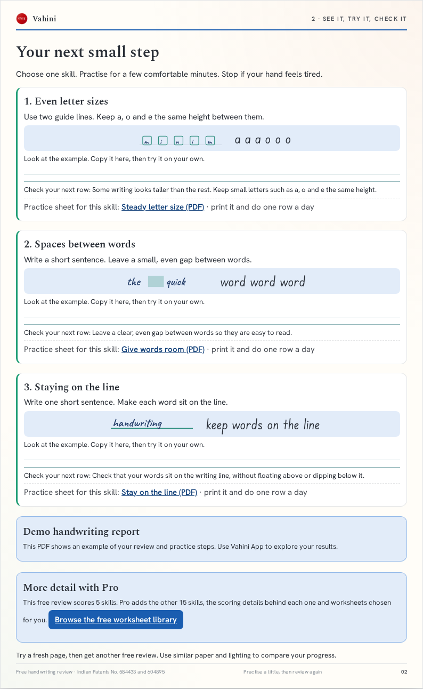
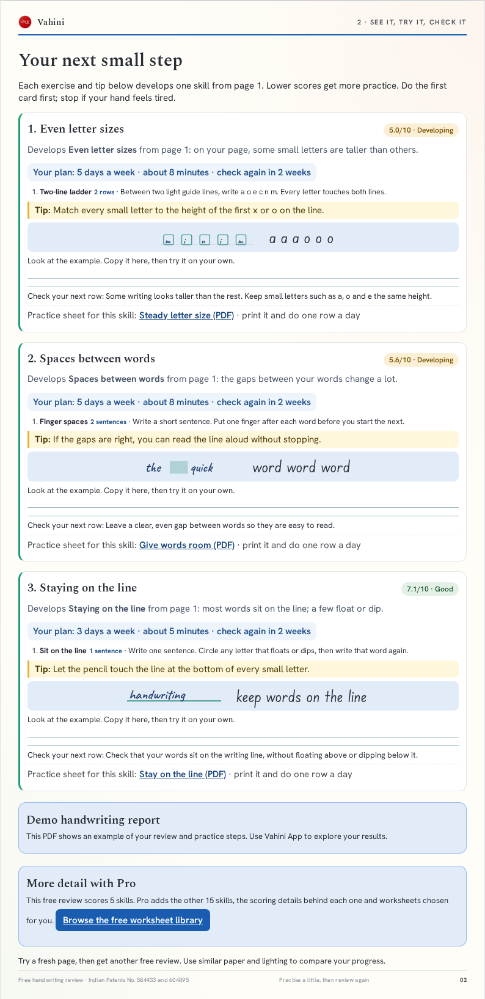
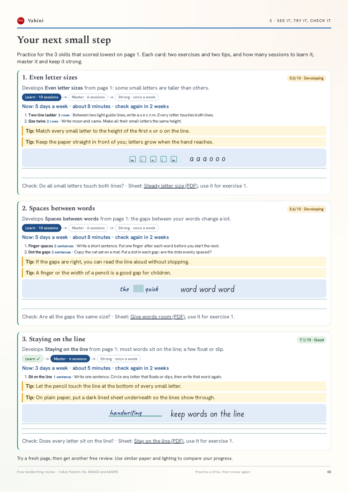
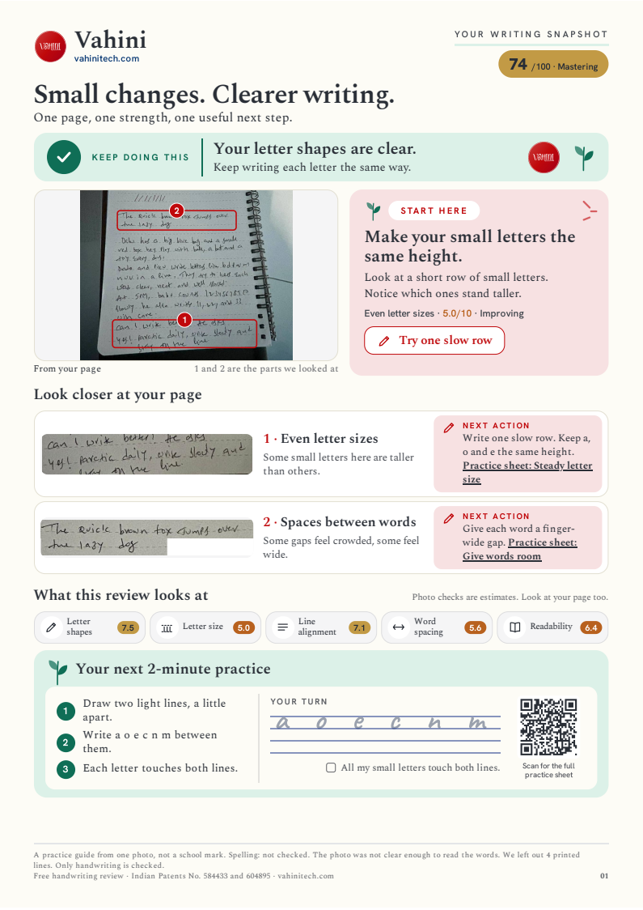
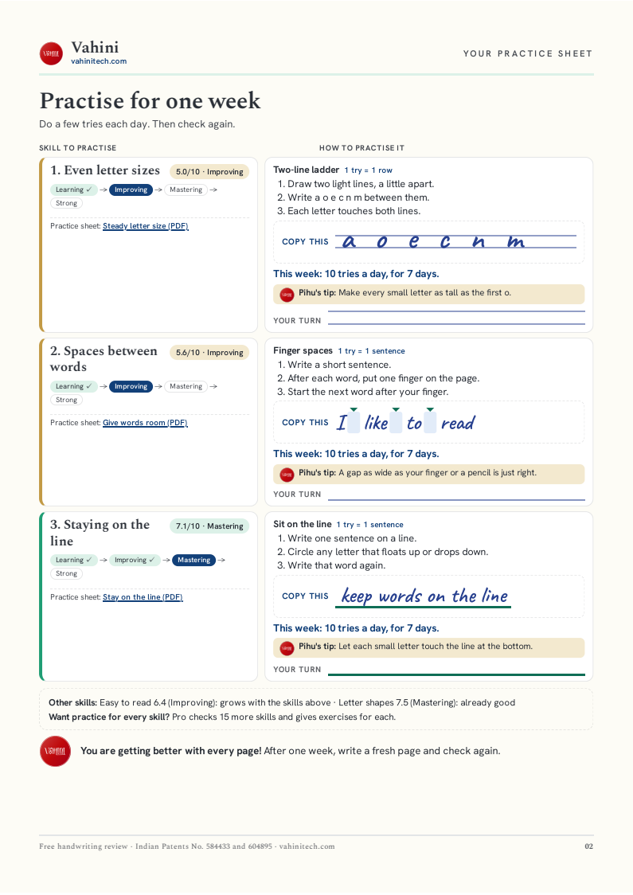
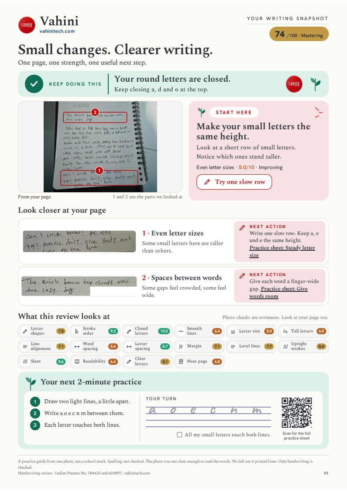
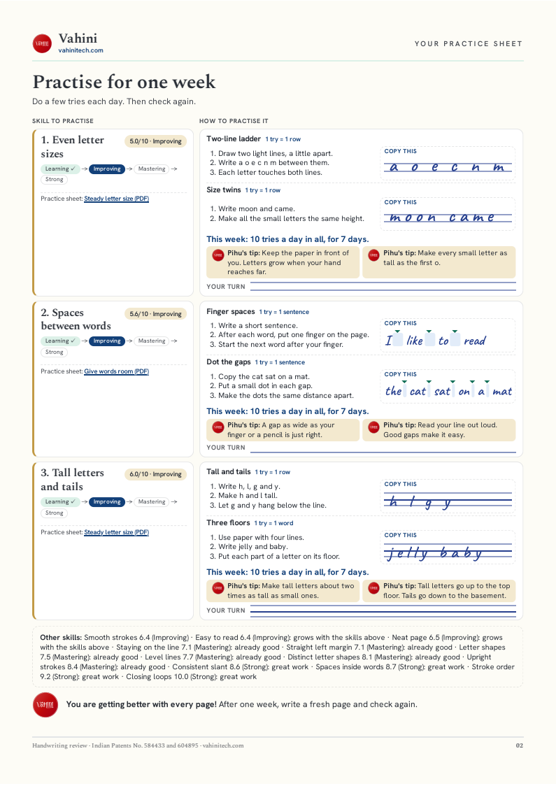

# Practice framework: exercises by factor, practice by score, report in the parent's language

Approved by the owner on 2026-10-11 in #122; the English report, the
catalogue and "Your progress" are built (see section 14). Sections 9 and 10
(print in Telugu, share on WhatsApp) are built with draft Telugu wording
that waits for a native speaker's check (see section 15). Report version C
(page 1 "Your writing snapshot", the practice sheet with drawings, plain
English, many-to-many selection, the shared PDF and the side panel) was
approved by the owner on 2026-10-11 and is section 16.

## 1. The problem

Feedback on the Free report:

- Page 1 says which skills are "Developing" or "Need support". Page 2 ("Your
  next small step") gives an exercise per card, but never says which skill it
  develops, what that skill scored, or why it was chosen.
- Every skill has exactly one exercise, hard-coded in
  `frontend/src/report/report-render.js` (`simpleDrills`), so a second check
  prints the same drill again.
- Every card says "do one row a day", whatever the score: a 3/10 and an 8/10
  get the same amount.
- The report is English only. A parent who reads only Telugu cannot use it,
  even when a volunteer who reads English ran the check for them.

| Today (stage, Free sample) | Proposed page 2, Free (printed PDF) | Earlier card layout, Pro (printed PDF) |
|---|---|---|
|  |  |  |

Both proposed versions were printed to A4 PDF through the report's own
`fitPrintPages()` and come out at **exactly two pages**. Printed in Telugu
(draft wording, earlier layout): [free-page2-telugu.png](practice-framework/free-page2-telugu.png).
Above the report, on screen only: [share-bar.png](practice-framework/share-bar.png)
(Print in, Print / Save as PDF, Share on WhatsApp).

## 2. Development areas: one node per skill, everything connected

Each factor is a **development area**. Everything the report says about that
skill hangs off the same node, so a weak loop score always brings loop
exercises and loop tips, never a generic drill:

```
development area (factor 3, loop closure)
├── meaning        "Round letters such as a, d and o are closed."
├── evidence       why it was flagged on THIS page (existing explanations, crops)
├── exercises[]    ordered by level: close the circle, gap hunt, tall loops
├── tips[]         short hacks: "close the door", "go back over the top of a and d"
├── worksheet      the printable that goes with it (letter-shapes)
└── i18n           the same, per language
```

The framework is agnostic in four ways:

- **Renderer:** the Free and Pro reports, the website's factor pages, the
  practice guide and the Android app all read the same nodes.
- **Language:** text is looked up by id per language (section 9).
- **Tier:** a policy table, not the code, decides how much each tier shows.
- **Measurement:** a node does not care whether its score came from a photo
  or the pen; `needs` filters what a report can offer.

Tier policy: no prices, only what each report shows. Only the skills the
report flags get practice: if letter spacing is the one to grow, the card
shows letter-spacing exercises and a letter-spacing tip and nothing else.

| Tier | Skills with practice | Exercises per skill | Tips per skill | Skills scored |
|---|---|---|---|---|
| Free | up to 3, the lowest scores first | 1 | 1 | 5 |
| Pro | up to 3, the lowest scores first | up to 2 (the band decides) | 2 | all photo-scored |

The numbers are configuration, not code. The server resolves them from the
visitor's plan and returns them with the access answer (`/api/v2/me`,
`practice: {areas_max, exercises_max, tips_max}`), so a new paid plan
changes what a report shows without a frontend release. The catalogue's
`tiers` block holds the defaults.

The full report's `coach_tips.py` keeps its cross-skill tips (style,
finishing letters, the labelled "fun" cards); a coach tip that belongs to one
skill moves into that skill's `tips`, so the two never repeat each other.

## 3. The exercise catalogue

The mapping lives in `backend/practice_catalog.py` (`FACTORS`: factor number to its
`exercises` and `tips`). For reading and review, [11-practice-map.md](11-practice-map.md) shows
the same mapping by factor name, generated by `scripts/practice_map.py` (CI checks it
is current).

One catalogue, owned by this repository, maps every factor to an ordered list
of exercises. Draft content for all 20 factors:
[practice-framework/practice-catalog.draft.json](practice-framework/practice-catalog.draft.json).

Each exercise:

| Field | Meaning |
|---|---|
| `id` | Stable, `<skill>.<name>`, never reused. Reports and events name exercises by id. |
| `level` | 1 is the first to try; higher levels come once the earlier ones are done. |
| `title` | Two or three words, shown in bold. |
| `steps` | One or two plain sentences, at most about 120 characters, for a child or a parent to follow. |
| `example` | What to write, shown in the handwriting face (empty when the exercise is about the page). |
| `check` | One self-check question, asked after the practice. |
| `unit` | What one try is: a row, sentence, word, line, letter or page ("1 try = 1 row"). How many tries comes from the band (section 4). |
| `script` | `any`, or `latin` when it only makes sense for the Latin alphabet (joined writing, a-o pairs). |
| `needs` | `photo` (scored from a photo today) or `pen` (factors 13 to 16, scored by the pen; never chosen from a photo report). |
| `worksheet` | Optional worksheet id from the website catalogue, the printable that goes with it. |
| `i18n` | Per language: `title`, `steps`, `check` (and `example` where the example is not Latin). Section 7. |

Each tip: `id` and `text` (one sentence, a hack the child can remember), plus `i18n`.

Composite factors (18 legibility, 20 neatness) carry their own exercises
but are chosen only when no single factor explains the low score, as today.

## 4. Practice by score: tries, a week at a time

Children understand "try it 10 times" better than sessions or minutes. A
**try** is doing the exercise once: one row, one sentence, one word, as the
exercise says ("1 try = 1 row"). Practice runs a week at a time: try it a set
number of times a day for 7 days, then check again.

| Band | This week | Then |
|---|---|---|
| Just starting (below 4.5) | try it 15 times a day, 7 days | check again |
| Growing (4.5 to 6.9) | try it 10 times a day, 7 days | check again |
| Getting strong (7 to 8.4) | try it 5 times a day, 7 days | check again |
| Strong (8.5 and up) | 10 tries once a week, to keep it | check again in 4 weeks |

Each skill also shows where the child is on the path, by band:
**Learning** (below 4.5) → **Improving** (4.5 to 6.9) → **Mastering** (7 to
8.4) → **Strong** (8.5 and up). A check after each week of tries moves the
child along; about 100 tries usually come before a move, which the card
does not promise. These are
practice targets, not predictions: the next check decides the stage, and the
report never promises a score. A 20-minute daily cap still applies when a
child has several cards; past it, later cards ask for fewer tries.

## 5. Choosing exercises and tips (only for the skills the report flags)

Since version C this is many-to-many: see section 16, "Many-to-many
selection". The steps below still hold for which skills get a row.

1. Priorities are chosen as today (up to three; a spelling finding may take
   one slot; lowest measured non-composite factors below 8.5).
2. For each priority, and only for it, take min(band exercises, tier `exercises_max`)
   exercises in `level` order, and the tier's number of tips in list order,
   skipping `needs: pen` on a photo report and `script: latin` when the page
   is in another script.
3. A re-check moves on: the browser already keeps the last check (scores and
   date, `history`); it will also keep the exercise ids printed last time, so
   the next report starts after them and comes back to level 1 when the list
   runs out. Nothing about it leaves the browser.

## 6. Page 2: each skill beside its exercise

Page 2 is a two-column table, one row per skill to grow, so the exercise is
always next to the skill it develops:

| Left: the skill, from your page | Right: your exercise for it |
|---|---|
| Number, skill name, score and stage ("5.0/10 · Improving") | Exercise title and what one try is ("1 try = 1 row") |
| The stage path: Learning → Improving → Mastering → Strong, current stage filled in, earlier ones ticked | The steps, and what to write, in the handwriting face |
| What we saw on this page, in encouraging words | "This week: 10 tries a day, for 7 days. Then check again!" |
| The example cut from the child's own photo (the same crop as page 1) | Pihu's tip, and a writing line to try it once |

- **Up to three skill rows**, the lowest-scoring flagged skills first.
- **A spelling row** when the limited spelling check found a word: "We read
  recieve. Did you mean receive? Check it against your page." with a
  look-cover-write exercise. It is extra to the three skills, and appears
  only when there is a finding. (The mock-up shows an example row; the
  sample photo has no misspelling.)
- **Other skills we checked**, at the end: the remaining scored skills by
  name with score and stage, a word of praise for the strong ones, then
  "Want practice for every skill? Pro checks 15 more skills ... and gives
  exercises and tips for each one." No prices.
- Little Vahini and Bheema open the page, Tara closes it (section 8).

Stage names follow the band: Learning (below 4.5), Improving (4.5 to 6.9),
Mastering (7 to 8.4), Strong (8.5 and up). Page 1 keeps the photo and the
five skill cards, with the same stage names.

The whole report is two A4 pages: the mock-up above, with three skills, a
spelling row and the other-skills box, was printed through
`fitPrintPages()` and is exactly two pages, with room to spare.

## 7. Words for children

Children read this report, often with a parent. A child who feels judged
stops practising, so every sentence encourages:

- **Start with a strength.** Page 2 opens with the best-scoring skill:
  "Great work on letter shapes!"
- **Skills to grow, not weaknesses.** Never "weak", "poor", "bad", "wrong",
  "problem", "inadequate", "fail" or "lowest". Say "skills to grow" and
  "your next step".
- **Describe the writing, not the child.** "A few small letters grew taller
  than the rest", never "you write untidily".
- **Friendly band labels** on both pages:

  | Band | Today | Proposed | Telugu (draft) |
  |---|---|---|---|
  | below 4.5 | Needs support | Learning | నేర్చుకుంటోంది |
  | 4.5 to 6.9 | Developing | Improving | మెరుగవుతోంది |
  | 7 to 8.4 | Good | Mastering | పట్టు సాధిస్తోంది |
  | 8.5 and up | Strong | Strong | బలంగా ఉంది |

- **Short and doable.** "A few minutes a day is plenty."
- **Celebrate progress.** A gain since the last check is named first
  ("+0.6 since last time!"), and the page ends on encouragement: "You are
  getting better with every page."
- Scores stay visible (parents and teachers need them) but are framed as
  tracking, not marks: "Scores are practice guides, not school grades."

A test scans every report string and catalogue text (all languages) for the
banned words, and the `natural-writing` skill carries the list.

## 8. Vahini and friends on the report

The story characters make the report friendly for children, each with one
job they can recognise:

| Character | Where | Job |
|---|---|---|
| Little Vahini | top of page 2 | cheers the strength: "Great work on letter shapes!" |
| Bheema | beside that line | the practice buddy: "a few tries a day is plenty!" |
| Pihu | every tip | "Pihu's tip:" |
| Tara | end of page 2 | "You are getting better with every page!" |

The drawings are proprietary and never enter this AGPL repository. As with
the error-screen pictures (`window.VAHINI_NOTICE_ART`), the host page passes
a map of same-site image paths, `window.VAHINI_REPORT_ART`
(`cheer`, `buddy`, `tip`, `encourage`); vahinitech.com fills it from the
drawings library's cut-outs. Without the map (a self-hosted analyser) the
report has no pictures and the same layout. The pictures are small (26 to
52 px) and printed; the printed Free mock-up with all four is two pages.

## 9. Print in the parent's language

Many parents who need this most do not read English. The planned drives work
like this: a volunteer who reads English runs the check with the family,
then prints or saves the report **in the family's language**.

- A "Print in" dropdown sits next to Print / Save as PDF: English, then
  తెలుగు (Telugu) first, then other languages as their translations are
  reviewed (Hindi, Tamil, Kannada, Malayalam). Choosing one re-renders both
  pages in that language; scores, crops and the page photo do not change.
- Every sentence in the report comes from string tables keyed by id
  (`frontend/src/report/strings/<lang>.js`) and from the catalogue's `i18n`. A
  missing translation falls back to English for that sentence only, and a
  test lists what is missing.
- Fonts: Noto Sans Telugu (OFL) and the other Noto faces are bundled with the
  analyser frontend, so a printed or saved PDF shows the script correctly
  on any device.
- Translations are written and checked by a native speaker before a
  language appears in the dropdown. Machine translation may draft, never
  ship unchecked. Factor names keep a short English term in brackets on
  first use so a teacher and a parent can talk about the same thing.
- The spelling note stays honest: in another language it says the check
  covered English words only.
- The anonymous `report_printed` event gains the language code, so the
  Friday report shows which languages families print in. Nothing else.
- Later, not in this change: the analyser page itself in Telugu, for
  families who run the check on their own.

## 10. Share on WhatsApp

Next to Print / Save as PDF (screen only, never printed):

- **Phase 1:** "Share on WhatsApp" sends a short summary in the chosen
  language: the overall score, one strength, the next skills with this
  week's plan and the first exercise, and a link to the free check. On a
  phone it uses the share sheet (`navigator.share`), elsewhere
  `https://wa.me/?text=`. No child's name, no photo, no crops. Nothing passes
  through our server; the only record is an anonymous `report_shared` event
  with the channel and language.
- **Phase 2 (owner decision):** share the PDF file itself. The report prints
  through the browser today and cannot make a PDF file on its own; doing so
  needs a PDF library in the page (about 300 KB). On Android, "Save as PDF"
  and then sharing the file already works.

## 11. Who owns what

| Piece | Where | Notes |
|---|---|---|
| Catalogue data | `backend/practice_catalog.py`, validated at import | Draft JSON here becomes this module |
| Served to clients | the versioned factor catalogue (`/api/v2/catalog/<version>`): `factors[n].exercises`, `practice.dosage` | Schema change in `backend/schemas/catalog.schema.json`; the version hash changes, clients refetch |
| Report rendering | `frontend/src/report/report-render.js` reads the catalogue; `simpleDrills` is removed | Same cards for Free and Pro |
| String tables | `frontend/src/report/strings/<lang>.js` | English is the source |
| vahini-web | factor pages show "How to practise" from the same catalogue (`tools/gen-factor-pages.mjs --sync`); Bheema's practice plan can use it later | One source, so a page never promises an exercise the report does not have |
| Android app | reads the same catalogue | No API change needed |

## 12. Tests

- Catalogue: every photo-scored factor has at least two exercises; ids
  unique and stable; every `worksheet` exists in the worksheet catalogue;
  dosage covers every band; every factor has at least two tips; the tier
  table covers free and pro; steps within the length limit; no em dashes.
- Report: only flagged skills get cards; Free shows one exercise and one tip per card; each card names its factor, score, band, stage and plan; the exercise
  count follows the band and the tier, the tips follow the tier, and every
  exercise and tip shown belongs to that card's factor; the daily cap holds; a re-check starts
  after last time's exercises.
- Characters: with `VAHINI_REPORT_ART` the four pictures appear and the report still prints on two sheets; without it, none appear and nothing breaks.
- Words: no banned word in any report string or catalogue text, in any language.
- Share: the WhatsApp text holds no name and no image, and follows the chosen language.
- Print: one A4 sheet per page in English and in Telugu, longest case;
  Telugu glyphs render (no boxes) in the saved PDF.
- i18n: every key in English exists in each listed language, or is reported.

## 13. Rollout

1. Owner approves this design and the mock-ups.
2. Analyser PR: catalogue module, schema, renderer, tests (English only).
3. Analyser PR: string tables, Telugu translation reviewed by a native
   speaker, fonts, "Print in" dropdown.
4. vahini-web: pin bump; factor pages gain "How to practise".

## 14. As built (English, 2026-10-11)

- `backend/practice_catalog.py` holds the catalogue (the draft JSON here is
  its source), checked on import: unique ids, two exercises and two tips for
  every photo-scored factor, worksheet ids that exist, steps of at most 140
  characters, no avoided word, no em dash. It is served in the versioned
  factor catalogue, and `/api/v2/me` returns the tier's numbers.
- The browser uses the catalogue served with the report's dictionary
  version, or the copy `frontend/build_bundle.py` packs into the bundle.
- Page 2 follows the approved mock-up. Where it differs, on purpose:
  the spelling row says "the reader can misread words too" (the mock-up's
  "mistakes" is on the avoided list, which a test enforces); the skill's
  practice sheet link sits under the crop; Pro's exercise column is wider
  (2:3) so two exercises and two tips per skill still print on one sheet;
  with two exercises the plan says "10 tries a day in all".
- The 20-minute daily cap (section 4) is not built: the catalogue has no
  minutes per try to add up.
- "Your progress" (screen only): saved checks for this writer, a comparison
  with an earlier one (up arrows only; a fall says it needs a few more
  tries), a progress file to download and load, and forget with a confirm
  step. It sends nothing. Exercise and tip ids are saved with each check so
  the next report moves on, wrapping to level 1.

## 15. As built (Telugu and WhatsApp, 2026-10-11)

The owner asked on 2026-10-11 to start Telugu printing and WhatsApp
sharing. What is built:

- **String tables.** Every sentence the two pages, "Your progress" and the
  share summary print is in `frontend/src/report/strings/en.js` (the
  source) and `te.js`, keyed by id, with `{placeholders}` and explicit
  `one`/`other` forms for counts; `frontend/src/report/i18n.js` looks them
  up and falls back to English for any id a language lacks.
  `tests/report-strings.test.mjs` lists missing ids and fails while
  `te.js` lacks any. English renders exactly as before: the same HTML,
  checked on the sample report and its variants before and after the move,
  and by switching to Telugu and back (`tests/report-language.mjs`). Not in
  the tables: the patent line in the footer (owner instruction, it stays as
  written), the worksheet titles (names of English PDFs), the Latin practice
  words drawn in "Copy this", and the renderer helpers no page calls
  (`classificationPanels` is a refusal screen, not the report).
- **Catalogue.** Each exercise and tip carries `i18n.te` (exercises:
  `title`, `steps`, `check`; tips: `text`). Examples stay Latin, because
  the child practises English letters. The import check fails on a missing
  translation, an em dash, a judging word (`AVOID_WORDS_TE`, a draft list
  for the reviewer) or text longer than about 1.5 times the English
  (`translation_limit`). Catalogue version `85108292a841082ce34e`;
  [11-practice-map.md](11-practice-map.md) shows the Telugu under each English
  line, marked draft.
- **Skill names** keep their English name in brackets on first use on each
  page, for example "అక్షరాల పరిమాణం సమానంగా (Even letter sizes)". Stage
  names: నేర్చుకుంటోంది, మెరుగవుతోంది, పట్టు సాధిస్తోంది, బలంగా ఉంది.
- **"Print in"** (`#report-lang`, beside Print / Save as PDF on
  `analyser.html` and `sample-report.html`, screen only) redraws both
  pages and "Your progress" with `lang="te"`; scores, crops, the page photo,
  the exercises chosen and the pictures do not change. The choice is kept in
  this browser (`localStorage` `vahini_report_lang`, guarded: with storage
  blocked it lasts for the page).
- **Font.** Noto Sans Telugu, regular and bold, Telugu subset from the
  `@fontsource/noto-sans-telugu` 5.3.0 npm package, unchanged, with its OFL
  (`frontend/assets/fonts/`, `sources.json`, the SBOM and
  THIRD-PARTY-NOTICES). Its `unicode-range` holds only Telugu, so English
  words keep their faces and an English page never downloads it. In Telugu
  the labels drop their letter spacing, which splits Telugu letters.
- **Print.** Both pages print on two A4 sheets in English and Telugu, Free
  and Pro, in the longest case, with and without pictures and with
  stretched sheets. `fitPrintPages()` now tries the floor (0.78) before it
  lets a page spill: with the host's fonts, Pro's longest practice page
  needed 0.76 by its first measure and printed on three sheets in English
  too; at the floor its wider reflow fits.
- **Share on WhatsApp** (`#share-whatsapp`, screen only): the overall
  score, the strongest skill, each skill to grow with its score, this
  week's tries and first exercise, and
  `https://vahinitech.com/analyser/analyser.html?from=whatsapp`, in the
  chosen language. A touch-first phone with a share sheet gets
  `navigator.share({text})`; otherwise `https://wa.me/?text=` opens. Never
  the name, the photo, a crop, a recognised word or an id; no request goes
  to our server.
- **Not built:** the language code on the `report_printed` record and a
  `report_shared` event. The print record goes to vahini-web's store
  through its own schema, and the analyser has no anonymous event helper
  for report actions, so neither was added here.
- **Before production:** a native speaker reads every Telugu line in
  `te.js` and in the catalogue (and `AVOID_WORDS_TE`) and corrects it.
  Until then the Telugu is draft, and the vahini-web pin bump that takes it
  to production waits for that check.


## 16. Version C (owner approval, 2026-10-11)

The owner approved "version C" of the report on 2026-10-11: "go with C,
build and deploy to stage and use vahini branding logo website, patent
details those things will be present in the report". The mock-ups are in
the PR (#126). The report follows the vahinitech.com theme: colours are
`var(--v-*)` tokens from `/site/design/v1/vahini.css`, and the only colour
codes of its own are the four score colours.

As built, printed through `fitPrintPages()` from the sample report (two A4
pages in every case):

| Free page 1 | Free page 2 | Pro page 1 | Pro page 2 |
|---|---|---|---|
|  |  |  |  |

Free page 1 in Telugu (draft wording): [c-free-page1-telugu.png](practice-framework/c-free-page1-telugu.png).
On screen with the side panel: [c-screen-side-panel.png](practice-framework/c-screen-side-panel.png).

### Page 1, "Your writing snapshot" (Free and Pro)

The Vahini logo, "Vahini" and vahinitech.com; "Your writing snapshot" with
the overall score in a pill coloured by band (85 and up green, 70 to 84
yellow, 45 to 69 orange, below 45 red; Strong, Mastering, Improving,
Learning); "Small changes. Clearer writing." and "One page, one strength,
one useful next step."; a green "Keep doing this" band for the strongest
measured skill (composites left out), with the host's `cheer` picture and a
drawn leaf; the photo zoomed (an SVG viewBox over the photo) to the parts
the next rows point at, with numbered boxes from the factor regions, never
cutting a box; "Start here" for the first skill to grow (its goal, what to
look at, its score in its band colour and stage, "Try one slow row");
"Look closer at your page", up to two rows (the first two skills to grow;
a spelling finding takes the second): the crop, what we saw, one next
action and that skill's practice sheet; "What this review looks at", a
chip per scored skill with a drawn icon and its score in its band colour;
"Your next 2-minute practice", the first exercise's numbered steps, its
example in light grey between two guide lines to trace, an empty pair, a
tick box with its self-check, and a QR code that opens the first skill's
worksheet PDF; screen-only "Download my practice sheet (PDF)" and "Check
another page"; and the footer with the patents, vahinitech.com, the
spelling note and "A practice guide from one photo, not a school mark."

Not built: height bars and gap markers on the crops. The analyser does not
measure letter heights or word gaps per letter yet, so the report draws
nothing that would look like such a measure.

### Page 2, the practice sheet

The same rows as before (the skill on the left with its stage path and
practice sheet, how to practise on the right), in plain English, with a
drawing for each exercise that shows what its steps say. Each exercise
names its drawing in the catalogue (`model`): `ladder` (two lines, the
letters exactly between them), `zones` (four lines), `baseline` (words on a
bold line), `gaps` (words with finger-wide gap blocks), `letter-gaps`,
`margin`, `slant` (slant guides), `loops`, `trace`, `start-dots`, `pairs`,
`waves` and `page`. "Your turn" lines match the drawing. The page head has
the logo and vahinitech.com, the footer the patent line.

Second round (owner, 2026-10-11, mock-up in #126): under each skill's
stage path, the left column now says **why it helps** (one short sentence
about everyday life), a green box **"You'll know it's working when ..."**
naming a small win the child can see, and **"More:"** with the skill's page
on vahinitech.com (`handwriting-<skill>.html`, a link on screen and the
address when printed), above the practice sheet link. The texts are data:
`why`, `win` and `page` per factor in `backend/practice_catalog.py`
(`ABOUT`, Telugu in `TELUGU_ABOUT`, draft), checked on import (one
sentence each, at most 60 and 56 characters, plain words, no claim word,
a known page) and served in the catalogue from version
`82ca133f7363f8489dd8`. The left column never makes a row taller than its
practice: `trimSkillColumns()` measures each row on screen and before
printing and drops "More" first, then the "why" line, then the win box
(`data-trim` on the row; `tests/report-layout.mjs`). Telugu text runs
longer, so a Telugu row usually keeps the win box and the practice sheet
only.

Before the closing line, a note in the theme's soft blue, **"Every child
learns to write at their own pace."**: short, happy practice helps most
children; if writing is still very tiring, slow or painful after a few
weeks, a teacher or an occupational therapist can help, with
vahinitech.com/signs-child-needs-handwriting-help.html. The report never
diagnoses, never promises a cure or to "overcome" anything, and never reads
personality from handwriting: the import check and
`tests/report-words.test.mjs` refuse "cure", "overcome", "disorder" and
"diagnos..." in catalogue and report text. The "Other skills" box text is
larger (12.5 px Free, 11.5 px Pro).

### Plain English

A parent with basic English and a child of 8 read the report. Every step is
at most three short sentences, one action each ("Draw two light lines, a
little apart. Write a o e c n m between them. Each letter touches both
lines."); no sentence in a step, check or tip runs over 14 words, and
checks are statements to tick ("All my small letters touch both lines.").
`practice_catalog.py` refuses anything longer on import. The report's own
sentences are held to 16 words, and an average under 10, by
`tests/report-strings.test.mjs`. The Telugu was redrafted to match and is
still draft until a native speaker checks it.

### Many-to-many selection

Every exercise and tip says which skills it helps: `helps`, factor number
to weight, its own factor at 1.0 and others at 0.3 to 0.8 where the
practice truly helps them (the two-line ladder helps even letter sizes at
1.0 and tall letters and tails at 0.6). A report chooses, in
`frontend/src/report/practice-select.js`, deterministically:

1. **Need** for each measured skill: `max(0, 8.5 - score) x reliability`
   (measured 1.0, estimated 0.6). A composite (18 legibility, 20 neatness)
   passes its need to the skills it is made of, by the weights
   `backend/scoring.py` blends them with (a test keeps the two in step).
2. **Rows** are the flagged skills, as before (the lowest measured
   non-composite skills below 8.5, up to the tier's `areas_max`).
3. **Value** of a candidate: the sum of `helps[f] x need[f]`, minus 100
   when it was printed last time (rotation through the history kept in
   this browser), minus 0.75 for each level above 1 (a child starts with
   the first exercises).
4. **Greedy picks**: the first skill to grow picks first, then the row with
   the most need left. A row takes candidates only from its own skill's
   list, so every printed entry's highest-weight factor is a flagged skill
   (tested). After a pick, each skill it helps keeps `1 - weight / 2` of
   its need, so the next pick goes after what is left. Ties go to the lower
   level, then catalogue order. Exercises per row follow the band and the
   tier (`exercises_max`), tips the tier (`tips_max`); tips are chosen the
   same way.
5. **Tries a day** follow the row's own skill (owner, 2026-10-11): its
   stage sets them (Learning 15, Improving 10, Mastering 5 a day, Strong 10
   once a week), even when the exercise also helps a weaker skill. The
   selection still picks exercises by the combined need above; only the
   tries come from the row.

`tests/practice-select.test.mjs` checks the need, the composites, the same
picks for the same report, rotation, the tier limits and that every printed
entry belongs to a flagged skill. `scripts/practice_map.py` shows each
entry's `helps` in [11-practice-map.md](11-practice-map.md).

### Share the PDF on WhatsApp

This replaces the text summary of section 10. "Share PDF on WhatsApp" makes
the two report pages into a two-page A4 PDF in the browser, in the language
chosen in "Print in": html2canvas draws each page at twice its CSS size
(about 190 dots per inch on A4) and jsPDF puts the pictures on A4 pages
(both MIT, vendored unchanged in `frontend/scripts/vendor/` with
`sources.json`, in the SBOM and THIRD-PARTY-NOTICES, about 620 KB together,
loaded only when the button is pressed and stamped like every other asset
through `<template id="pdf-libs">`). A phone that can share files
(`navigator.canShare({files})`) opens its share sheet with the PDF, where
the family picks WhatsApp; anything else saves the PDF and opens
`https://wa.me/?text=` with a note to attach it. The PDF holds what the
report shows, including the name the family typed, if any. Nothing goes to
Vahini's server: making it fetches only the two library files.

The file is branded and never names the child (owner, 2026-10-11): it is
saved or shared as `Vahini-handwriting-snapshot-<YYYY-MM-DD>.pdf` in every
language, with the PDF title "Vahini handwriting snapshot", author and
creator "Vahini Technologies · vahinitech.com" and subject "Free handwriting
review" ("Handwriting review" for Pro). Its pages keep the website theme
(`print-color-adjust: exact`); `tests/report-language.mjs` samples page 1's
"Keep doing this" band and "Start here" card in the PDF image and fails if
they come out as plain paper.

### The side panel

On screens 1200 px and wider a sticky panel beside the report holds "Print
in", "Share PDF on WhatsApp", "Print / Save as PDF", the next steps
`analyser.html` showed under the report (practise the worksheet, check
again on a date, what a photo cannot see), "Your progress" and the Sponsors
line; narrower screens show the same panel under the report. It is never
printed and never in the shared PDF.

On the sample report the panel also holds **"About this sample"**: how the
sample was made and links to the Free and Pro examples, the before and after
stories and "Analyse your own page". They used to sit in a dark banner over
the report; the page's heading and intro stay. `analyser.html` has no such
banner (its toolbar holds only "Run another").

### Characters

The host's `cheer` picture moved to page 1's "Keep doing this" band; `tip`
(Pihu, in each tip) and `encourage` (Tara, closing page 2) stay. `buddy` is
no longer used: version C has no opening line on page 2.
