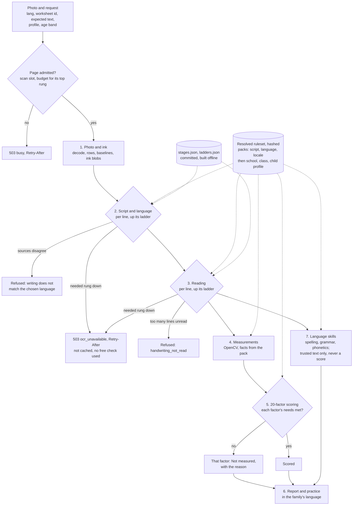
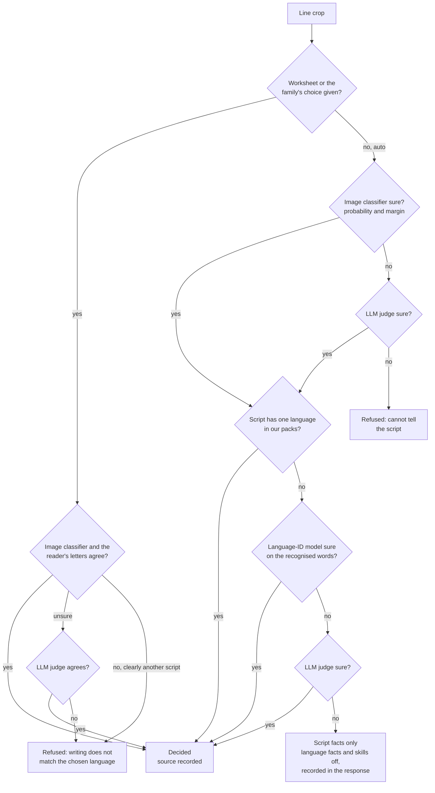
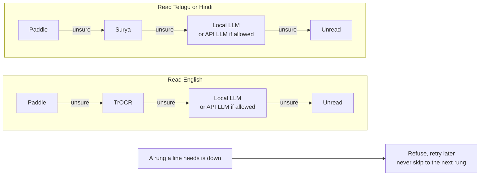
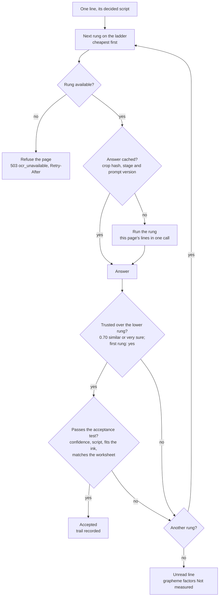
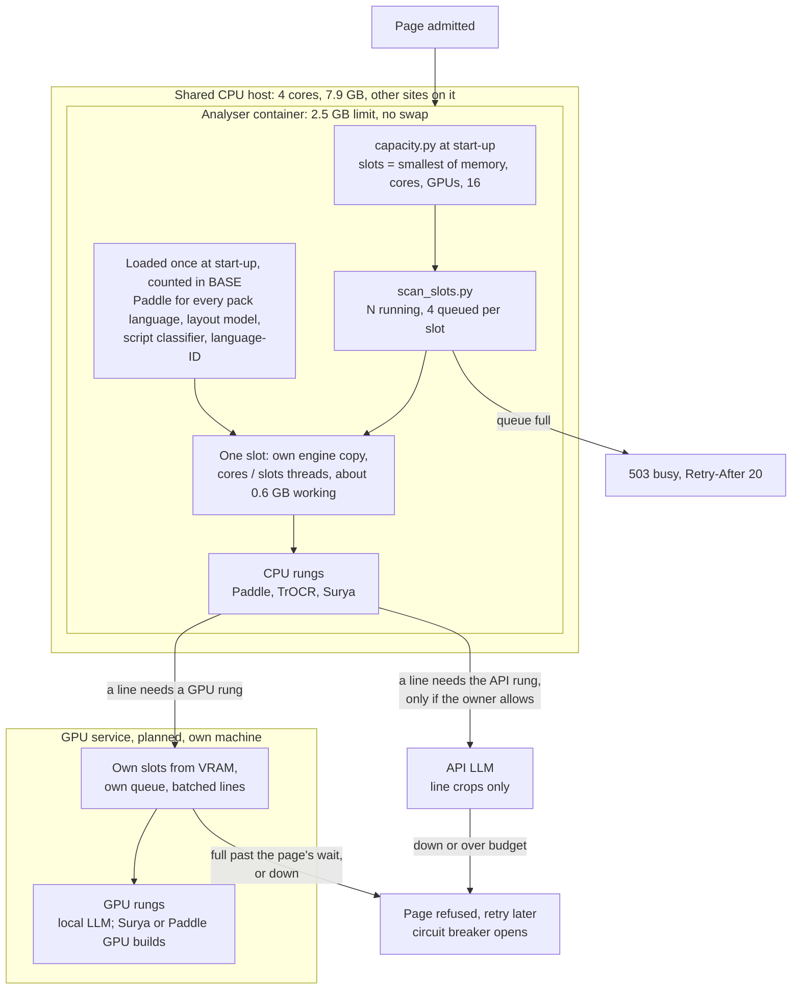

# Languages: one analyser, many scripts

This is a design, not a description of the code. Nothing below is built yet
except where a section says "today". It explains how the analyser should
grow from English (plus Telugu in development) to German, Hindi and the
English variants without copying the 20 factors once per language, and the
order to build it in. Builds on
[01-system-architecture.md](01-system-architecture.md),
[02-how-a-scan-works.md](02-how-a-scan-works.md),
[03-scoring-criteria.md](03-scoring-criteria.md) and
[06-reading-engines.md](06-reading-engines.md).

Line references are to `main` at 2ee37f4 (20 October 2026). Work is
tracked in #217, one issue per step of section 12. Section 19 lists the
gaps a self-review found and where each is fixed.

## 1. The problem today

English is not a setting in the analyser; it is spread through the code as
letter lists and `[A-Za-z]` tests. Each module decided for itself what
"Latin" means:

| Where | What it assumes |
|---|---|
| `backend/scoring.py:502-505` | loop letters `[aodpegq]`, tall letters `[bdfhkltgjpqy]` |
| `backend/scoring.py:620` | `BOWL_LETTERS = set("abdegopq")` |
| `backend/scoring.py:673` | `_LATIN_ONLY = (3, 6)`, factors that count Latin letters |
| `backend/scoring.py:744` | about 5 letters per word as the ideal (factor 15) |
| `backend/vision/zone_analysis.py:55-57` | ascenders `[bdfhklt]`, descenders `[gjpqy]`, `[A-Za-z]` |
| `backend/vision/letter_geometry.py:43` | x-height letters `acemnorsuvwxz` |
| `backend/vision/tbar_analysis.py:35-36` | the `tt` and `t[lhkb]` patterns |
| `backend/vision/finishing_letters.py:22-24` | finishing letters `adhilmnrtu`, words `[A-Za-z]+` |
| `backend/vision/style_analysis.py:44,56,69` | cursive check only above 90% ASCII letters |
| `backend/report/coach_tips.py:65` | `_latin_share`, gating seven tips at 0.9 (lines 264 to 612) |
| `backend/reading/classify.py:49,200,291` | English form words, uppercase share, `[A-Z]{5,}` |
| `backend/vision/computer_vision.py:275,865` | fallback lines tagged `"en"`, `[A-Za-z]` letter count |
| `backend/reading/line_recovery.py:188,252` | `lang="en"` defaults |
| `backend/reading/recognizer.py:53,232` | `_INDIC_LANGS` sends te/hi/ta/kn/ml to Surya, the rest to TrOCR |
| `backend/reading/ocr_backends.py:55` | a line is Telugu if any character is in U+0C00 to U+0C7F |
| `backend/reading/ocr_backends.py:661` | TrOCR model fixed to `microsoft/trocr-base-handwritten` (English) |

The line numbers are from when this design was written. The letter facts
have since moved to the language packs (#223), and `scoring.py` is split
into `backend/scoring_parts/` (#227).

Telugu today is a set of exceptions on top of that. The script is known
only from the characters the reader returned (`ocr_backends.py:55`);
nothing looks at the ink to decide it. `recognizer.telugu_not_read`
(`recognizer.py:383-415`) refuses a Telugu page unless Telugu letters are
at least 75% of the letters read and the mean confidence is at least 0.80.
`VAHINI_INK_GEOMETRY_LANGS` (`config.py:153`, empty by default) measures a
Telugu page from rows found in the ink without reading it, and then only
factors 7, 8, 11, 12 and 20 are measured that way (`NEEDS` in
`factor_needs.py`, #225).
Factors 3 and 6 report "script_not_supported" when no Latin letters were
read (`scoring_parts/availability.py:67-80`).

One more gap shows how deep the assumption goes. The passage alignment
normalises text with `re.sub(r"[^\w ]", "", ...)` (`recognizer.py:441`).
Python's `\w` does not match combining marks, so every vowel sign and
virama is dropped: పిల్లి compares as పలల and हिंदी as हद. Alignment
against a Telugu or Hindi worksheet compares consonant skeletons.

Adding German this way would mean a third set of exceptions; Hindi a
fourth. The fix is to move every one of these facts into data, keyed by
script and language, and have the code ask for them.

## 2. Six layers

| # | Layer | Language-aware? | Output |
|---|---|---|---|
| 1 | Photo and ink | No | cleaned image, ink mask, rows with baselines, ink blobs |
| 2 | Script and language decision | Yes | one decision per line: tag, source, confidence |
| 3 | Recognition | Yes, by registry | lines, words and graphemes with boxes and confidence |
| 4 | Measurements | Through pack data only | named features (row slopes, gaps, zone heights, loop closure) |
| 5 | 20-factor scoring | Through pack data only | 20 results, each scored or "Not measured" with a reason |
| 6 | Report and practice | Yes | words, tips and worksheets in the family's language |
| 7 | Language skills | Yes | spelling, grammar and phonetic findings on trusted text; never a score (section 18.2) |

The whole path, with every place a page can stop:



Layers 1, 4 and 5 hold no language names. They receive a resolved
ruleset (the language packs plus any profile, section 18) and read facts from it ("which letters close a loop", "where
are the zones"). A test enforces this (section 12, step 1).

Layer 1 is mostly built: `ink_geometry.py` already finds rows and
baselines without reading anything, and that is what makes it the common
ground for every script.

## 3. Names

Every language is a BCP 47 tag with an explicit script subtag inside the
analyser: `en-Latn-IN`, `en-Latn-US`, `en-Latn-GB`, `de-Latn-DE`,
`te-Telu-IN`, `hi-Deva-IN`. Script codes are ISO 15924 (`Latn`, `Telu`,
`Deva`). The request may keep sending short tags (`en`, `te`); the server
fills in the script and a default region, so `te` resolves to
`te-Telu-IN`.

## 4. Language packs

A pack is a JSON file of facts. Packs inherit, most general first:

```
base  ->  script (Latn, Telu, Deva)  ->  language (en, de, te, hi)  ->  locale (en-IN, en-US, en-GB, de-DE)
```

JSON rather than YAML because the backend has no YAML dependency today and
the contracts are JSON Schema already. Proposed layout:

```
backend/languages/
  registry.py               load, inherit, validate, cache
  pack.schema.json
  scripts/Latn.json  Telu.json  Deva.json
  langs/en.json  de.json  te.json  hi.json
  locales/en-IN.json  en-US.json  en-GB.json  de-DE.json
```

What lives at each level:

| Level | Holds |
|---|---|
| Script | Unicode ranges; the writing unit (letter for Latin, akshara for Telugu and Devanagari); the zone model; letter classes (closes a loop, rises above the body, drops below the baseline, carries a mark above); confusable pairs |
| Language | alphabet and marks in use; average word length; finishing letters; words that mark a printed form; recogniser preferences; tip and exercise catalogue ids |
| Locale | the letter model taught in school; spelling variant; ruling (four-line notebook, single line); norm bands by age |

Every field in a child pack says how it combines with its parent:
`set` replaces, `add` and `remove` change a list. The resolved pack is
hashed and checked against the schema, and CI resolves every pack in the
repository. A script pack also says its `direction` (`ltr` or `rtl`):
factor 10 measures the edge a line starts from, and slant is signed by
direction, so a right-to-left script such as Urdu can be added without
reading every left margin as a right one. Until then such scripts stay at
level 0.

The Latin pack starts as exactly today's constants, so the first version
changes no score:

```json
{
  "script": "Latn",
  "unicode": ["0041-005A", "0061-007A", "00C0-024F"],
  "unit": "letter",
  "direction": "ltr",
  "zones": ["ascender", "body", "descender"],
  "zone_ratio": {"body_to_ascender": 0.5},
  "classes": {
    "loop": "aodpegqAODPEGQ",
    "bowl": "abdegopq",
    "ascender": "bdfhklt",
    "descender": "gjpqy",
    "body_only": "acemnorsuvwxz"
  }
}
```

The zone models differ by script, and this is where most of the real work
is:

- **Latin:** ascender line, body (x-height), baseline, descender line.
  Today's 1:2 rule in `zone_analysis.py`.
- **Devanagari:** a headline (shirorekha) joins the letters of a word along
  the top; some vowel signs sit above it, others below the body. The
  headline is a strong anchor that Latin does not have: a straight,
  continuous headline is a measurable sign of control.
- **Telugu:** no headline. The tick on top of many consonants (talakattu)
  belongs to the letter, vowel signs attach above and to the right, and
  the subjoined consonants (vattulu) sit below the row, often written
  apart (`ink_geometry.py` already allows for this when it fits
  baselines).

The Telugu and Devanagari letter classes are not written by an engineer
guessing. Each list is reviewed by a teacher of that script, checked
against the script sheets from vahinitech/EdTechBooks, and the reviewer is
recorded in the pack.

## 5. Script and language decision

Decided per line, because an Indian page often mixes English and Telugu.
Sources, strongest first:

1. **The worksheet.** When the page is one of our sheets, its manifest
   already says the script and the exact text.
2. **The family's choice** (the request `lang`).
3. **An image classifier** on each line crop that never reads a letter.
   It is the same kind of small model as `print_hand.py`, trained on line
   crops of Latin, Telugu and Devanagari writing.
4. **The reader's output** as a cross-check: the Unicode script of the
   recognised characters, which is the only signal used today.

If the sources disagree beyond a set margin (the family chose Telugu, the
classifier and the reader both see Latin), the page is refused with a
clear message, as `telugu_not_read` does now. A guessed language gives a
different score for the same photo, which breaks the rule in
[02-how-a-scan-works.md](02-how-a-scan-works.md) that the same photo gets
the same score. "auto" without a worksheet uses 3 and 4 only.

The image settles the script, not the language. English and German are
both Latin, and no ink classifier tells them apart. Within a script the
language comes from the recognised text: a small language-identification
model over the line's words, with a language model as the tie-breaker
only when that is unsure (section 16).

Only the script can refuse a page. Most factors need the script's facts
(rows, zones, letter classes), not the language's. When the language
stays unknown, the page is scored on the script's facts alone, the
language-level facts (word length, finishing letters, form words) and
the language skills are off, and the response says so. Refusing would
turn away a page we can measure perfectly well.

The decision has a script and a language for each token, not only for the
line. "నా school bag" is one line in two languages; the English word does
not make the Telugu line a disagreement, and the language skills skip it.
Telugu or Hindi written in Latin letters, common in messages, is Latin
script: it is scored as Latin writing, and the language skills stay off
unless a pack for it (`te-Latn`) exists.

The decision goes into the response with its source, so a report can be
traced back to why it was scored as Telugu. Each way it can end:



## 6. Recognition registry

`_INDIC_LANGS` and the TrOCR default become one table: for each script, the
engines in order of preference, each with the model id and the maturity it
has reached on our pages.

| Script | Today | Registry entry, first try |
|---|---|---|
| Latn | Paddle PP-OCRv5 server rec; TrOCR base handwritten in hybrid | same; German needs a model that reads ä ö ü ß |
| Telu | Paddle `te_PP-OCRv5_mobile_rec`; Surya in hybrid | same, plus the trained line reader when it lands |
| Deva | Surya in hybrid | Surya; Chandra OCR 2 is listed in 06 as stronger on Indic and is not deployed |

Every engine returns the same shape: lines, words and graphemes, each with
a box and a confidence, text in Unicode NFC. Layers 4 and 5 never see an
engine name.

Which engine runs first, and when the next one is asked, is the ladder in
section 17: cheapest first, a step up only for lines the cheaper engine
was unsure of, and a refusal rather than a quiet substitute when a needed
engine is down.

### 6.1 A reader for handwritten Telugu (2026-10-20)

PP-OCRv5's Telugu model reads print; on handwriting it returned Latin
fragments. `backend/reading/telugu_reader.py` is a reader trained on handwriting:
a small convolutional network with two bidirectional LSTM layers and CTC,
about 1.3 million weights stored as 8-bit integers, run in numpy like
`print_hand.py`, so the same crop gives the same text and the image needs
no torch. It reads a word or a whole row.

`scripts/train_telugu_reader.py` trains it on IIIT-INDIC-HW-WORDS-Telugu
(CC BY 4.0, https://ilocr.iiit.ac.in/dataset/23; the owner is asking the
authors to confirm in writing). The splits are by writer: training has
writers 1, 2, 3, 5, 7 and 8, validation 4 and 10, test 9, 12 and 13, so
the test score is on hands the reader never saw. Half the samples are
lines of two to four words; each is turned, slanted, blurred and lit
unevenly to look like a phone photo. The score is the character error
rate in graphemes and the share of words read exactly, of the exported
weights through `telugu_reader.py`.

Where it trains (`scripts/train_guard.py`): a CUDA GPU, Apple's GPU, else
the CPU. On the CPU it uses half the cores, runs niced, and before every
batch checks the memory the machine has free and its own size: below
`--floor-mb` it saves a checkpoint and waits, above `--max-rss-mb` it
saves and exits with code 75, and `--resume` carries on. On the
vahinitech.com server (4 cores, production beside it) one epoch takes
about three hours; the Mac Studio is the planned machine.

```
python scripts/train_telugu_reader.py --train train.zip --val val.zip \
    --test test.zip --work runs/te1 --out runs/te1/results.json
```

The reader is not used by a scan yet. It joins the Telugu ladder
(section 17) when its test score passes the bar the owner sets for
level 2 (section 11), measured on real children's pages from the pilot
schools as well as the IIIT test writers.

## 7. Graphemes and copy tasks

Counting characters is wrong for Indic scripts: one written akshara can be
three code points (consonant, virama, consonant) plus a vowel sign. The
measuring unit is the grapheme cluster (Unicode extended grapheme clusters,
with the akshara rule for Telu and Deva), and every per-letter feature
counts in those units.

The copy task is the strongest tool we have for every language.
`align_to_expected` (`recognizer.py:417`) and the request's
`expected_text` already turn free reading into checking a known passage.
The design keeps that and fixes it for Indic scripts: compare grapheme by
grapheme with marks kept, so a missing vowel sign is a difference and not
an invisible one. Worksheets give the expected text, so a child writing on
our Telugu sheet can be measured long before open Telugu reading is good.

One rule keeps the passage honest. When a line matches its passage, the
known text replaces the reading (`recognizer.py:417-430`). How many loop
letters or tall letters should be on the line may come from that text;
evidence that they were written comes only from the ink. Factor 3 already
works this way (`scoring_parts/features.py:249-261`: the expected bowls
from the text, the found bowls from the ink). Every factor that counts
letters gets a test that a passage cannot raise its score on a page whose
ink did not change.

## 8. Measurements and what each factor needs

Each factor declares what it needs; the scoring layer checks the needs
against what layers 1 to 3 produced for this page and this script. When a
need is missing, the factor is "Not measured" with the reason, never a
number estimated from the wrong script. Today's three special lists
(`_LATIN_ONLY`, `_NEEDS_RECOGNITION` at `scoring.py:804`, `_INK_MEASURED`)
are replaced by this one rule.

Needs: `rows` (ink rows with baselines), `words` (word boxes), `graphemes`
(read graphemes with boxes), `confidence` (reader confidence), `zones` (the
pack's zone model fitted to the page), `classes` (a letter class from the
pack), `sensor` (pen data), `apart` (letters written apart: not joined
cursive, #277).

| # | Factor | Needs | Notes |
|---|---|---|---|
| 1 | Letter Formation Accuracy | rows, confidence | |
| 2 | Stroke Order Consistency | graphemes, confidence | |
| 3 | Loop Closure | graphemes, classes.loop | Telugu has many closed shapes; needs the reviewed list |
| 4 | Line Quality (Smoothness) | rows | |
| 5 | Size Consistency | rows | body-only class sharpens it where the pack has one |
| 6 | Ascender / Descender Control | zones | becomes "zone control" per script (see section 10) |
| 7 | Baseline Alignment | rows | |
| 8 | Word Spacing | words | from a passage when the script has no reliable word reader |
| 9 | Letter Spacing | graphemes, apart | joined cursive has pen lifts, not letter gaps: "Not measured" (#277) |
| 10 | Margin Discipline | rows | |
| 11 | Line Straightness | rows | |
| 12 | Vertical Alignment | rows | |
| 13 | Speed Consistency | sensor | |
| 14 | Pressure Consistency | sensor | |
| 15 | Stroke Continuity | sensor | its word-length term moves to the language pack |
| 16 | Pen Lift Frequency | sensor | |
| 17 | Slant Consistency | words | |
| 18 | Legibility | composite of 1, 5, 7, 8 | measured when its parts are |
| 19 | Character Distinction | graphemes, confidence | confusable pairs from the pack |
| 20 | Overall Neatness | composite of 5, 8, 10, 11, 17 | measured when its parts are |

Two thirds of the factors need only rows and words. That is why a new
script can start giving useful, honest results before anyone can read it.

## 9. Norms

The target bands in `scoring.py` were fitted on Latin writing, and the
roadmap already lists that as a gap for Telugu
([16-roadmap.md](16-roadmap.md)). Bands become a table keyed by factor,
script and age band, stored with the locale pack. A cell with no fitted
band falls back to the script's band, then to today's band marked
provisional. A provisional band is never shown as a firm score; how that
looks on the report is an owner decision (section 10).

## 10. Report and practice

The practice catalogue already has a language list (`practice_catalog.py:130`,
`LANGUAGES = ("te",)`) and a `script` field on each exercise that must be
`any` or `latin` (`practice_catalog.py:1920`). That field grows to script
codes. Tips gated by `_latin_share` move to the same pack lookup.

**Report changes need the owner's approval first.** Renaming factor 6 to
"zone control", showing which language a page was scored as, marking a
band as provisional, or showing a Telugu factor name on the printed page
all change the report. Each needs before and after screenshots and
@vkosuri's approval in the issue or PR, under
[12-report-rules.md](12-report-rules.md#report-format-baseline-owner-approval-required).
Until then the report keeps its current labels, and the new fields live
only in the JSON.

**Every language keeps the English report** (owner, 2026-10-23: the report
will come in many languages, and it is credible only if each looks like
the English one). Only the words change. Fonts, sizes and places are
the rule in [12-report-rules.md](12-report-rules.md#every-language-keeps-the-english-report),
held by `tests/report-parity.mjs`. Adding a report language:

1. Words: `frontend/src/report/strings/<lang>.js` with every id of `en.js`
   (`tests/report-strings.test.mjs`), reviewed by a teacher who writes the
   language. Keep sentences no longer than the English: a longer one makes
   the renderer hide a line in a practice row or zoom a printed page, and
   the parity test lists each case under "words longer than English".
2. The language and its script in `frontend/src/report/i18n.js` (`LANGS`,
   `SCRIPT`). A script without capitals is already in `CASELESS`.
3. A script other than Latin: its faces in
   `frontend/styles/report-fonts.css` under the three existing names,
   `Vahini Script Serif`, `Vahini Script Sans` and `Vahini Script Hand`, each
   limited to the script's letters with `unicode-range`. Use Google Noto
   (Noto Serif and Noto Sans in the script), the one family designed for
   every script, self-hosted from the `@fontsource` packages with the
   licence, `sources.json`, `THIRD-PARTY-NOTICES.md` and SBOM entries. Add
   a row per face to `scripts/report_font_scale.mjs` and set each face's
   `size-adjust` to what it measures.
4. Latin languages (German, French, Spanish, Portuguese) need no font:
   Spectral, Hanken Grotesk and Caveat carry their letters. Edu SA Beginner,
   the tracing face of the practice lines, has no accented letters, so a
   language whose practice words have them needs a tracing face first.
5. Nothing in `report.css` or the renderer may name a language. Run
   `npm run test:parity`: it fails on any element whose font size, weight,
   line height or font list differs from English, any block that moves,
   a print longer than two A4 pages, a face not scaled to its English face,
   or a character no report font covers.

## 11. Maturity levels

Each language pack carries its level. The server never scores above it.

| Level | What runs | Example today |
|---|---|---|
| 0 | Practice sheets only; the check refuses the page | Hindi, Tamil, Kannada |
| 1 | Ink geometry: factors from rows and passages; the rest "Not measured" | Telugu, behind `VAHINI_INK_GEOMETRY_LANGS` |
| 2 | Reading: a recogniser passes a held-out set of real pages; letter-shape factors turn on | |
| 3 | Calibrated and public: bands fitted on children's pages in that script, and a public test page passes | English |

Level 3 is the only one the website may claim. vahini-web holds the same
rule: Telugu scoring is not claimed until a public test shows it works (a
test on 19 October 2026 found the sinking line on 1 page in 20). Each pack names its own benchmark set (pages, transcripts, source and
licence, like `benchmarks/uji-clean`); no pack passes level 1 without one,
and CI replays every pack's set. The bar
for each step (pages, accuracy) is set per language by the owner and
written into the pack, the way `TELUGU_MIN_SHARE` and
`TELUGU_MIN_CONFIDENCE` are constants today.

## 12. Build order

Each step is one PR, and each keeps the benchmark green
([18-benchmark.md](18-benchmark.md)). Steps 1 to 3 must not move a single
number in `benchmarks/*/expected.json`.

1. **Packs for what exists, no behaviour change.** (#206) Add
   `backend/languages/` with the registry, the schema and `Latn`/`en`
   packs holding today's constants. Point `scoring.py`, `zone_analysis.py`,
   `letter_geometry.py`, `tbar_analysis.py`, `finishing_letters.py`,
   `style_analysis.py`, `coach_tips.py` and `classify.py` at the pack.
   Add a test that fails on a letter list, `[A-Za-z]`, a Unicode script
   range or `isascii()` in a scoring module outside `backend/languages/`.
2. **Factor needs.** (#207) Declare `needs` for the 20 factors and replace
   `_LATIN_ONLY`, `_NEEDS_RECOGNITION` and `_INK_MEASURED` with the one
   check. The "Not measured" reasons stay word for word.
3. **Recognition registry.** (#208) Replace `_INDIC_LANGS`
   (`recognizer.py:53`) and the TrOCR default (`ocr_backends.py:661`) with
   registry lookups; engines return graphemes.
4. **Graphemes and alignment.** (#209) A grapheme splitter, and
   `align_to_expected` comparing graphemes with marks kept. English is
   unchanged; Telugu alignment gets stricter, which is the point.
5. **Script decision, logging only.** (#210) The per-line decision from section
   5, recorded next to today's character-based tag on every scan but not
   used, until the two have been compared on real pages.
6. **Script decision in charge** (#211), with the refusal on disagreement.
   `telugu_not_read` becomes the general case.
7. **Request contract** (#212, section 13).
8. **Telugu pack:** (#213) zones, loop and mark classes reviewed by a Telugu
   teacher; ink geometry reads it. Level 1 to 2 when the reader passes.
9. **German pack:** (#214) `de` and `de-DE`, the letter models taught in German
   schools, ä ö ü ß in the classes, a reader that keeps them, and the
   English form words in `classify.py` checked against German pages.
10. **Hindi pack:** (#215) `Deva` zones with the headline, a headline continuity
    measurement, and Surya as the first reader.

11. **Language-model service** (#218), off by default: the `ScriptJudge`
    and `Reader` interface, a local adapter first, measured like any
    other reader before it enters the registry (section 16). It can start
    after steps 3 and 5; an API adapter waits for the owner's privacy
    decision.

12. **Ladders and the cascade** (#219): `stages.json`, `rank_stages.py`,
    `ladders.json` and the escalation loop from section 17. It lands
    right after step 3 and before step 5, because the script decision and
    every new reader run through it.

13. **Profiles** (#220): the profile schema, resolver and limits from
    section 18.1. Needs step 1's pack resolver and step 7's `profile`
    field.
14. **Language skills** (#221): first the `craft.js` gate on the resolved
    language, which can land as soon as the response carries one; then
    layer 7 from section 18.2, after step 4's graphemes.

Norm tables (section 9, #216) start as soon as there are real children's
pages for a script; they do not wait for step 10.

## 13. Contract change

The request schema allows `^([a-z]{2,8}|auto)$`
(`schemas/report-request.schema.json:54`). `resolve_langs`
(`recognizer.py:64-73`) already accepts comma lists such as `en,te`, which
that pattern rejects, so the schema is already narrower than the server.

Proposed pattern, which keeps every value valid today:

```
^(auto|[a-z]{2,3}(-[A-Z][a-z]{3})?(-[A-Z]{2})?(,[a-z]{2,3}(-[A-Z][a-z]{3})?(-[A-Z]{2})?)*)$
```

The request gains two optional fields: `profile` (section 18.1) and
`age_band` (for example `6-7`; never a birth date), so age norms (section
9) have something to key on. Today the request has no age at all. Until
the owner decides who may keep profiles (open question 8), `profile`
carries the profile itself as JSON, at most 16384 bytes, and nothing is
stored (#220); an id and version can replace it once profiles are kept.

The response gains, additively: a `language` object (resolved tag, source
of the decision, pack level), a `script` per line and per token, and
`ruleset`, the hash of the resolved packs and profile. `comparability`
([19-comparison-data.md](19-comparison-data.md)) gains `ruleset` and the
ladder version, so the paid before/after comparison can tell a real change
in the writing from a change in our rules. The cache key
already includes `lang` (`cache.py:32`); it should use the resolved tag so
`te` and `te-Telu-IN` share an entry.

Order across repositories, as always: this repository's PR first, then the
contracts sync and tag in Umbrella, then vahini-web and the app.

## 14. Which language next

**English variants are not new languages here.** `en-US`, `en-GB` and
`en-IN` share the script, the reader and every factor. They differ in the
letter model taught in school, spelling (colour and color), the paper (the
four-line notebook common in Indian primary schools) and, once there is
data, the age bands. That is a locale file each, not code.

**German is mostly a pack.** It is Latin, so steps 1 to 4 do most of the
work. The new facts are ä ö ü ß, nouns written with a capital, longer
compound words (the word-length term in factor 15), and the school
scripts: German states choose between Lateinische Ausgangsschrift,
Vereinfachte Ausgangsschrift, Schulausgangsschrift and the print-based
Grundschrift, so `de-DE` needs a way to say which one a child learned.

**Hindi is the strongest choice after those.** In the 2011 Census 43.6% of
people in India gave Hindi as their mother tongue, and in 2024 Hindi was
the most chosen medium for the class 10 and 12 board exams (39.3%). It
shares Telugu's structure (consonants with vowel signs, conjuncts), so the
akshara work for Telugu carries over, and its headline gives a new
measurement for free. Surya already reads it in hybrid mode. The weak spot
is data: DohaScript (February 2026, 531 writers) is adult handwriting, and
there is no public set of children's Devanagari writing that we found. We
would collect our own, as for Telugu.

After Hindi, Kannada is the cheapest next Indic script because its letter
shapes are close to Telugu's.

## 15. Spelling and the 20 factors

Spelling, grammar and phonetics stay out of the 20 factors. Handwriting
quality does not depend on whether a word is spelt right. They are layer 7
(section 18.2), which runs on trusted text only. On 7 October 2026 a 104,000-word
English dictionary run over one fixture photo flagged 31 of 81 recognised
words, nearly all of them reader mistakes rather than the child's, so a
dictionary on open writing measures the reader, not the writer. For Telugu
the useful checks are phonetic: short and long vowel signs, aspirated and
plain consonants, and conjuncts.

## 16. Language models: where they help and where they do not

A vision-language model (a local one, or an API such as Claude, Gemini or
GPT) can help in two layers: deciding the script and language (layer 2)
and reading (layer 3). Measuring and scoring (layers 4 and 5) stay with
OpenCV and the deterministic code in `scoring.py`. A language model never
produces a number that goes into a factor. Every score has to trace to
code ([03-scoring-criteria.md](03-scoring-criteria.md)), and the same
photo has to get the same score.

**Script and language decision.** A language model is a fifth source in
section 5, asked only when the cheaper sources are unsure: the image
classifier gives no clear script, or the language-identification model
cannot choose between two languages of one script. It never overrides
the worksheet or the family's choice; if it disagrees with them the page
is refused, as with any other disagreement.

**Reading.** A language model is one more engine in the registry (section
6), not a replacement for it. The analyser already runs two
vision-language readers, Surya and PaddleOCR-VL (`ocr_backends.py:785`,
`:905`), and already guards against them: a stronger engine's reading
replaces Paddle's only when the two are at least 0.70 similar or the
engine is very sure (`config.py:133-143`), because below that the
difference was mostly invented text. A general language model gets the
same guard, and three more rules:

- **It must copy, not correct.** A language model reads what the child
  meant: it fixes a misspelling, closes an open letter, finishes a word.
  For a handwriting check that is wrong, because the mistakes are what we
  measure. The prompt asks for an exact transcription, the answer is
  compared with the classic reader, and on a copy task with the
  worksheet's text. When the model's text matches the worksheet better
  than the ink does, that is a warning sign, not a success.
- **Its confidence is not used.** Factors 1, 2 and 19 use the reader's
  per-character confidence. Language models do not give a calibrated one,
  so those factors keep the classic reader's confidence, or are "Not
  measured" when only the language model could read the line. The model
  may mark words it is unsure of; that marks a line, it is not a score.
- **Fixed answers.** A pinned model version (weights hash for a local
  model, the dated version for an API), greedy decoding, a versioned
  prompt, a JSON schema for the answer, and the answer cached by photo,
  model and prompt version. An answer outside the schema counts as no
  answer. An API that changes the model behind the same name changes
  scores, so the version goes into the response and into the benchmark's
  Layer B run.

**What is written on the page is not an instruction.** A page can say
"ignore the instructions above", by accident or not, and a vision model
reads it. So the model's answer is data only: a transcription, or a pick
from the scripts and languages we list, in a fixed JSON schema. Nothing it
returns is put into another prompt or treated as a rule, and a
transcription in a script other than the decided one is rejected.

**Where it runs.** Not in the analyser container. That container has a
2.5 GB memory limit on a shared CPU host and one scan already peaks near
1.6 GB ([13-api-and-capacity.md](13-api-and-capacity.md)); a 3 to 7
billion parameter vision model needs a GPU. The language model is a
separate service behind one internal interface (`ScriptJudge` and
`Reader`), with adapters for a local server (vLLM, llama.cpp or Ollama on
a GPU machine) and for API providers. Off by default. The analyser works
the same without it, with a timeout and a recorded "not asked" when it is
slow or down.

**Privacy.** An API model means a child's handwriting leaves our server.
Today's rule is that no deployed engine does that, and that a cloud API
needs explicit consent and a privacy review first
([06-reading-engines.md](06-reading-engines.md)); Chandra OCR 2 was removed
for this reason. That rule stands. A local model on our own GPU keeps the
photo on our machines and is the default path. An API path needs the
owner's decision, a provider that keeps nothing, a consent line for the
family, and the matching change to vahini-web's privacy page. Even then it
gets line crops after the layout filter, never the whole page, so a name
written at the top does not travel.

**Words, not runtime.** Language models are useful for drafting tips,
exercises and report strings in a new language at build time. A teacher
of that language edits them, and they go into the practice catalogue like
any other text. They are never generated per child at scan time.

**How it is judged.** Like any reader: character error rate per script on
the benchmark sets and on real photos, the share of lines where it
"corrected" the child, the share of answers outside the schema, and
repeat runs on the same photo. It enters the registry at the level those
numbers support (section 11), the same as Surya or Paddle.

## 17. Choosing a tool: ladders, escalation and fallback

Sections 5, 6 and 16 name many tools for the same job. This section says
which one runs, in what order, and what happens when one is unsure or
down. The rule underneath all of it: the path a page takes depends only
on the photo, the request and committed files, never on server load, time
of day or which model happened to be warm. Hybrid mode broke this once:
it skipped an engine for the rest of the page after one slow line, so the
same photo read differently on a busy server (#112, the note at
`recognizer.py:257-263`). The design below cannot do that.

### 17.1 Every tool is a stage

Each tool registers as a stage with facts about it, kept in a committed
file (`backend/languages/stages.json`), not measured at runtime:

| Field | Meaning |
|---|---|
| `task` | `script`, `language` or `read` |
| `scripts` | the scripts it handles |
| `quality` | a band per script (A best to D), from the benchmark |
| `cost` | measured p95 time per line on the deploy box, money per call |
| `where` | `server` (photo stays with us) or `leaves` (an API) |
| `fixed` | whether the same input always gives the same output |
| `level` | the maturity it has reached per script (section 11) |
| `version` | model id and weights hash, or the API's dated model |

`quality` and `cost` come from one tool, `scripts/rank_stages.py`, run on
the benchmark sets ([18-benchmark.md](18-benchmark.md)) and on the
deploy box, and committed with the numbers it used. A model change is a
change to this file, reviewed in a PR like a scoring change, and it reruns
the live benchmark.

Today's judgement, to be replaced by those measurements:

| Stage | Task | Quality, English hand | Quality, Telugu/Hindi hand | Cost | Where |
|---|---|---|---|---|---|
| Pack lookup | rules | exact | exact | instant, free | server |
| Image classifier | script | n/a | n/a | milliseconds | server |
| Language-ID model | language | n/a | n/a | milliseconds | server |
| Paddle | read | B | C | about 2.7 s a page on 4 threads ([13-api-and-capacity.md](13-api-and-capacity.md)) | server |
| TrOCR | read | A | none | slower than Paddle | server |
| Surya | read | B | B | slower than Paddle on CPU | server |
| Local LLM | script, language, read | A | A | seconds, GPU | server |
| API LLM | script, language, read | A | B | seconds plus network, per page charge | leaves |

The bands for the two LLM rows are a guess until #218 measures them.

### 17.2 Building a ladder

For each task and script, `rank_stages.py` builds the ladder once, offline:

1. **Filter.** Drop a stage that fails a hard rule: `where: leaves`
   unless the owner's policy allows it and the family agreed; `fixed:
   false` for anything that feeds a score; `level` below what the task
   needs for this script; not built into this deployment.
2. **Sort by cost.** On-server and free first, then by p95 time, then by
   money. Ties break on the stage name, so the order never depends on
   file order.
3. **Keep only stages that are better.** Walk the sorted list and keep a
   stage only if its quality band is strictly better than every cheaper
   stage already kept. A stage that is slower and no better can never
   help, so it is not on the ladder at all.

The result is a short list, cheapest first, where every step up is an
improvement. With the judgement table above:

| Ladder | Rungs |
|---|---|
| Read English | Paddle, TrOCR, local LLM (Surya drops out: slower than Paddle and no better than TrOCR) |
| Read Telugu or Hindi | Paddle, Surya, local LLM |
| Script | worksheet, family's choice, image classifier, local LLM |
| Language within a script | worksheet, family's choice, language-ID model, local LLM |

The same ladders, with where each one goes when a rung is unsure or down:



The worksheet and the family's choice are not stages to escalate past.
They are fixed facts: when they settle the question the ladder stops
there, and later stages may only confirm or refuse (section 5).

The ladder file is committed (`backend/languages/ladders.json`) and the
server reads it as is. Rebuilding it is a reviewed change.

As built (#219): the first rung is always the Paddle stage that found
the line, since Paddle detects every line and its reading comes with the
detection. Paddle mode has that rung alone and trocr mode adds TrOCR for
every script, as before. Only hybrid mode is ranked. While a stage's
quality or cost is `unmeasured`, which today is all of them, rule 3
cannot be applied, so a hybrid ladder is the route `stages.json` names
for the script, marked `basis: route`, and lists the stages that were
not measured. A hard rule that fails on a measured fact refuses the
route rather than follow it. The ranking itself is tested on made-up
facts, including the judgement table above, which gives the ladders in
this section.

### 17.3 Escalation: climbing on doubt

The server runs each line up its ladder and stops at the first rung
whose answer passes the acceptance test for that task:

| Task | Accepted when |
|---|---|
| Script | top script's probability and its margin over the second are both above the pack's limits |
| Language | language-ID probability above the limit, with enough words to judge |
| Read | line confidence above the script's limit; the text is in the decided script; the grapheme count fits the ink (section 7); on a copy task, the match with the worksheet line is above the limit |

A higher rung's reading replaces a lower one's only through the
existing guard: similar enough to the lower reading, or the higher engine
very sure (`config.py:133-143`, 0.70 similarity today). For an LLM rung,
section 16's extra rules apply: copy not correct, its confidence not
used. Confidences from different engines are never compared with each
other; the rung decides, not the number.

The limits come from measurements, not taste. Paddle's confidence of 0.9
on English and on Telugu does not mean the same accuracy, so
`rank_stages.py` maps each stage's confidence to its measured accuracy per
script on the benchmark sets, and the acceptance limit is the confidence
at which that accuracy reaches the pack's bar. It also counts how often a
stage is sure and wrong, the one failure escalation cannot catch; a stage
with too many of those is not allowed to be a ladder's first rung. These
checks run on the benchmark sets and consented pages only, never on
families' photos, which are not stored.

The test runs per line, so a page with one hard line sends one line up,
not the whole page. Lines that reach the same rung on one page go in one
call, which matters for an LLM where the cost is per call.

All of this is deterministic: the stages are fixed, the limits are in the
pack, and the cache key for a rung's answer is the line crop's hash, the
stage version and the prompt version. The same photo climbs the same
rungs and stops at the same one.

### 17.4 Fallback: when a rung is down

Escalation is about doubt; fallback is about a rung that cannot answer
(not built, not loaded, crashed, timed out). The rule is narrow:

- A rung that is down matters only if a line actually needs it. If every
  line was accepted below it, nothing changes and the page is scored.
- If a line needs a rung that is down, the server does not skip to the
  next rung or settle for the last accepted answer. It refuses the page
  with `ocr_unavailable` and `Retry-After`, as it already does when the
  reader fails (`server/app.py:333-345`). The refusal is not cached and
  does not use a free check.
- A remote rung (a GPU service or an API) gets a circuit breaker: after a
  run of failures it is marked down for a set time, so pages that need it
  are refused at once instead of waiting for a timeout each.

This costs some availability on hard pages, and that is the right trade:
a "try again in a minute" is honest, a different score for the same photo
is not.

There is one deliberate exception, and it is not automatic. An operator
can take a rung off a ladder (an API outage that will last days, a GPU
host being moved). That is a change to the ladder file, so every page
after it is read the same way, and the response carries the ladder
version so scores before and after can be told apart.

### 17.5 Budget per page, not per minute

A money or time budget that runs out halfway through a page would give
that page a shorter ladder than the same photo got an hour earlier. So the
budget is checked once, before a page starts: if today's API budget or the
GPU queue cannot take a page that might need the top rung, the page waits
in the existing queue or is refused as busy (the scan admission limit in
[13-api-and-capacity.md](13-api-and-capacity.md)). A page that starts gets
its whole ladder.

### 17.6 The algorithm

One line's way up its ladder, with each fallback:



The same in code:

```python
def read_page(lines, ctx):
    ladder = LADDERS["read"][ctx.script]       # committed, cheapest first
    results, needs = {}, {}
    for rung in ladder:
        todo = [l for l in lines if l.id not in results]
        if not todo:
            break
        if not rung.available():               # down, or circuit open
            return refuse("ocr_unavailable", retry_after=60)
        answers = rung.read_batch(todo, cache_key=(rung.version, PROMPT_V))
        for line, ans in zip(todo, answers):
            prev = needs.get(line.id)
            if prev is not None and not passes_guard(prev, ans, rung):
                continue                       # higher rung not trusted here
            if accepted(ans, line, ctx.pack, rung):
                results[line.id] = ans.with_trail(rung)
            else:
                needs[line.id] = ans           # carry the best so far up
    for line in lines:
        if line.id not in results:
            results[line.id] = unread(line, best=needs.get(line.id))
    if share_unread(results) > ctx.pack.max_unread:
        return refuse("handwriting_not_read")  # telugu_not_read, in general
    return results
```

The script and language decisions run the same loop over their own
ladders. An unread line is "Not measured" for every factor that needs
graphemes (section 8), and still counts for the factors that need only
rows.

As built (#219): the loop is `backend/reading/escalation.py`. Two parts wait for
other work. First, the acceptance test checks confidence and script share
against `reading.accept_confidence` in the line's pack. No pack sets that
limit until `rank_stages.py` calibrates one (section 19, gap 5), so a
reading is accepted at the top rung only, and every line climbs its whole
ladder as before. The ink and worksheet checks come with section 7.
Second, a line whose top reading fails the test keeps the best trusted
reading, as before, and is marked `accepted: false` in its trail. It is
not yet unread, because the share of unread lines that refuses a page is
open question 6.

### 17.7 What gets recorded

Each line in the response carries its trail: the rungs tried, the one
that answered, the ladder version and the stage versions. No photo, crop
or text leaves the response for this; the counts (how many lines climbed
to each rung, how many pages were refused because a rung was down, what
the API cost) go to the weekly report as anonymous numbers. When those
counts show a rung answering most lines on its own, that is the signal to
measure whether the rung below it is still worth running.

### 17.8 CPU, GPU and memory

How each step's time, memory and calls are measured, and how CI catches a
step that grows too fast, is [21-performance-and-coverage.md](21-performance-and-coverage.md).

What the analyser does today ([13-api-and-capacity.md](13-api-and-capacity.md),
`backend/server/capacity.py`): at start-up it works out how many scans can run at
once as the smallest of three limits, memory, cores and GPUs, capped at
16. It counts 1100 MB for the loaded process, 600 MB of working memory per
running scan and 200 MB for each extra engine copy, all overridable. The
container has a 2.5 GB limit with no swap. Each running scan has its own
engine copy using `cores / slots` threads; four more wait per slot; beyond
that the answer is 503 with `Retry-After: 20`.



What changes when ladders arrive:

1. **Every stage declares what it uses.** `stages.json` gains `device`
   (`cpu`, `gpu` or `remote`), `load_mb` (resident once loaded),
   `work_mb` (extra while it runs), `vram_mb` and `threads`, measured with
   `backend/tools/load_test.py` on stage, never guessed.
2. **Everything a CPU ladder can reach is loaded at start-up.** Today a
   Paddle language can be built the first time a request uses it
   (`recognizer.py:75-84`), which adds memory in the middle of a scan,
   exactly when the server is busiest. With packs, the set of languages is
   known before the first request, so `warmup_models.py` loads every one
   and it is counted in the start-up figure.
3. **The capacity sum includes the ladders.** The start-up figure becomes
   the sum of `load_mb` for every CPU stage on an enabled ladder, and the
   working memory per scan the largest `work_mb` among them plus the
   measuring. If not even one scan fits, the server refuses to start with
   that ladder and names the stage that did not fit, instead of being
   killed by the kernel later.
4. **The device is part of the stage.** Paddle on CPU and Paddle on GPU are
   two stages with two versions, because their numbers can differ in the
   last digits, and so can a score. `ladders.json` picks one per ladder.
   `gpu_detect.resolve_use_gpu`'s automatic choice becomes a start-up check
   that the configured device is really there, so a page cannot be read on
   a GPU one day and a CPU the next because a driver changed.
5. **GPU work is a separate service on its own machine.** Today's host has
   no GPU, and 2.5 GB is less than a vision language model needs. The GPU
   service sizes its own slots the way `capacity.py` does, from video
   memory: what is left after the model's weights, divided by the memory
   one batch needs. Lines from one page go in one batch, capped by the
   stage's batch size.
6. **The GPU service has its own queue.** A line that needs it waits, up
   to the page's wait limit. Past that, or if the service is down, the page
   is refused with a retry and the circuit breaker opens. Waiting changes
   when the answer comes, never what it is.
7. **An API rung uses no local memory beyond the crops.** Its limit is the
   money budget, checked per page before the page starts (17.5).
8. **What stays.** The container memory limit, equal memory and swap
   limits, `MALLOC_ARENA_MAX=2`, and the scan admission limit. A new stage
   is load-tested on stage before its numbers go into `stages.json`; the
   kernel's `oom` event on stage is the test failing.

## 18. Custom rules, exceptions and grammar

Packs are written by us and reviewed by a teacher of the script. That
leaves no way for the people who know a particular child to say what is
normal for them: a class taught a one-storey a, the names in a class, a
maths line that should not be read as a sentence. This section adds that,
without letting a custom rule move a score it should not.

### 18.1 Who sets what

| Level | Who | What they may set |
|---|---|---|
| Packs (script, language, locale) | Vahini, reviewed by a teacher of the script | everything in section 4 |
| School or class profile | a teacher | letter model (from the locale's reviewed list), accepted letter variants, ruling, class word lists and dictation lists, exception words, what to skip (digits, formulas), which language-skill checks run |
| Child | the family | the language, and whether the child was taught print or cursive |

A profile is JSON, versioned, and checked against `profile.schema.json`
when it is saved:

```json
{
  "profile": "class-3b",
  "version": 4,
  "extends": "en-Latn-IN",
  "letter_model": "print",
  "variants": {"set": {"a": ["one-storey", "two-storey"], "k": ["looped", "open"]}},
  "exceptions": {"add": {"words": ["Vahini", "Bheema", "Pihu"], "skip": ["digits"]}},
  "word_lists": {"week-7": ["because", "friend", "school"]},
  "checks": {"spelling": "word_list", "grammar": "off"}
}
```

Order: packs, then school, then class, then child. Every field says
whether it replaces (`set`), adds to (`add`) or takes away from
(`remove`) what came before; nothing merges by guesswork. The result, the
resolved ruleset, is hashed. The hash goes into the response, the cache
key and `comparability` (section 13). Same photo and same ruleset, same
score; a changed profile is a different ruleset, and a comparison says so.

What a profile can never do:

- **Run code.** Fixed fields and literal lists only. No regular
  expressions: a pattern a user types can hang the server on one page.
  Lists have size limits.
- **Change how a factor is computed.** No formula, weight or band. A
  profile can only pick among alternatives the locale pack already lists
  and a teacher of the script reviewed (letter models, variant sets, norm
  tables).
- **Make a score higher by removing evidence.** Taking every letter out of
  a class makes that factor "Not measured", never 10 out of 10.
- **Touch safety limits.** Not the refusal limits, not the ladders, not a
  language-model or API rung.

Exception words change two things only: the script and language decision
(a Latin name in a Telugu line is not a disagreement) and the language
skills (a name is not a spelling mistake). The ink of an exception word
still counts for every geometry factor, because it is still handwriting.

Letter variants matter once letter shapes are measured (level 2 and up,
section 11). Today factor 1 uses reader confidence and letter heights, not
shape templates, so a variant list changes nothing until then. That is
deliberate: the field exists so that schools can say it before it is
used.

What is built (#220): `backend/languages/profile.schema.json` and
`profile.py` resolve and hash the layers, the request carries them inline,
and an emptied letter class leaves factor 3 or 6 "Not measured"
(`factor_needs.CLASSES`). A profile may not empty every letter or every
small letter. The Latin pack's reviewed letter models and forms are empty
lists until a teacher reviews them. Exception words, skip rules, word
lists and checks are checked and hashed only, until the script decision
(#211) and the language skills (#221) read them.

**Privacy.** A profile holds teaching choices, never health, diagnosis or
ability notes, and the schema has no field for them. Exception lists can
hold children's names, so they are personal data: kept by the account that
made them, never sent to analytics, never sent to an API rung. A child's
own settings live on the family's device, or with "Keep my pages". Issue
#220.

### 18.2 Language skills (layer 7)

A separate section of the response, never an input to a factor score.

It runs only on text we can trust: a page matched to a copied or dictated
passage (`expected_text`), or a page read at the `high` level. Anything
else is "not checked", which is what today's spelling check already does
when the reading is unsure.

Its rules are data in the language pack, three kinds:

| Kind | Holds | Example |
|---|---|---|
| `skills.spelling` | locale spelling variants; class word lists from the profile | colour in `en-GB`, color in `en-US`; a week's spelling words |
| `skills.grammar` | token patterns from a fixed vocabulary, on known text only | a capital after a full stop; in German, a capital on a noun the worksheet has |
| `skills.phonetic` | pairs of graphemes that differ by one sound feature | Telugu and Hindi short and long vowel signs, aspirated and plain consonants, a conjunct written as two letters |

The phonetic rules are the useful ones for Indian scripts, and they need
no dictionary. On a copy or dictation task we know every grapheme that
should be there (section 7). Each difference between what was written and
what was expected is looked up in the pair lists and named: "long vowel
sign written short", "aspirated consonant written plain". That is a
finding a teacher can act on, and it comes from the child's own page.

Each token carries its own script and language (section 5), and the
skills run only on tokens in the line's language.

**A bug this exposes today.** The browser's English checks
(`frontend/src/engine/craft.js`) decide whether text is English by
counting non-ASCII characters (`craft.js:153-155`). German is mostly
ASCII, so a German page would get English homophone and misspelling
checks; so does Telugu typed or written in Latin letters. They should run
only when the server's resolved language is English. Issue #221.

A language model may draft grammar or phonetic rules for a new language
offline, for a teacher of that language to review, as with tips in section
16. It never runs these checks at scan time.

## 19. Self-review: gaps found and their fixes

Written after reading this design against the code on 20 October 2026.
Each gap is fixed in the section named, and tracked in the issue.

| # | Gap | Fix | Where |
|---|---|---|---|
| 1 | Nobody but an engineer can add a rule or an exception | School, class and child profiles as declarative data, with limits on what they can change | 18.1, #220 |
| 2 | Spelling and grammar had no design, and `craft.js` would run English checks on German and on Telugu in Latin letters | Language skills as layer 7, rules as data, trusted text only; gate `craft.js` on the resolved language | 18.2, #221 |
| 3 | An unknown language refused the page, though most factors need only the script | Only the script can refuse; an unknown language falls back to the script's facts with skills off | 5, #211 |
| 4 | One language per line cannot handle "నా school bag" or Telugu in Latin letters | Script and language per token; Latin-letter Telugu is Latin script | 5, #210 |
| 5 | A cheap reader that is sure and wrong never sends a line up the ladder | Calibrate each stage's confidence per script against measured accuracy in `rank_stages.py`, and set the acceptance limits from that; check sure-and-wrong rates on the benchmark sets and consented pages, never on families' photos | 17.3, #219 |
| 6 | A pack, profile or ladder change moves scores, and the paid comparison would read it as progress | `ruleset` hash and ladder version in the response and in `comparability` | 13, #212 |
| 7 | A language model reading a page can be steered by what is written on it ("ignore the instructions above") | Its answer is data only: transcription or a pick from listed scripts in a fixed schema; nothing it returns becomes part of another prompt or a rule; text in the wrong script is rejected | 16, #218 |
| 8 | When the known passage replaces the reading, a factor could count what should have been written as if it had been | Rule: how many letters were expected may come from the passage; evidence that they were written comes only from the ink (factor 3 already works this way, `scoring_parts/features.py:249-261`); a test per factor | 7, #209 |
| 9 | Right-to-left scripts (Urdu) would break margins and slant | `direction` in the script pack; factor 10 measures the starting edge; slant sign per direction; until then such scripts stay at level 0 | 4, #206 |
| 10 | Age norms are planned, but the request has no age | Optional `age_band` in the request, never a birth date; without it, bands are provisional | 9, 13, #212, #216 |
| 11 | Pack inheritance had no merge rules | `set`, `add`, `remove` on every field; the resolved pack is hashed and validated; CI resolves every pack in the repository | 4, 18.1, #206 |
| 12 | Each new pack multiplies what must be tested | Each pack names its own benchmark set (like `benchmarks/uji-clean`); a pack cannot pass level 1 without one, and CI replays every pack's set | 11, #206 |

Two drawbacks stay, on purpose:

- **Refusing when a needed rung is down costs availability.** With one GPU
  machine, an outage turns hard pages away until it is back. The
  alternative is a different score for the same photo, which is worse.
- **Declarative rules are less flexible than code.** A school will
  eventually want a rule the schema cannot say. The answer is a new field,
  added by us and reviewed, not a scripting language in profiles.

## Open questions for the owner

1. The bar for each maturity step per language: how many real pages, and
   what reading accuracy.
2. Whether the report names the language a page was scored as, and where.
3. Whether factor 6 is renamed for non-Latin scripts, and to what.
4. For German, whether to ask the family which school script the child
   learned, or detect it.
5. Whether there is a budget for a GPU machine for the local model and
   GPU builds of the readers, and where it would run.
6. The share of unread lines at which a page is refused, per script, and
   the daily money limit for an API rung if one is ever allowed.
7. Whether a language-model API may ever see a child's handwriting, and
   on what terms, or whether only a local model on our own GPU is allowed.
8. Who may create school and class profiles (Pro accounts only?), and
   whether a class exception list may hold children's names at all.
9. Whether the report shows the language-skills findings, and where.

Sources for section 14: [Census 2011 mother-tongue shares](https://www.thenewsminute.com/news/what-india-speaks-south-indian-languages-are-growing-not-fast-hindi-83823);
[2024 board-exam medium](https://www.legacyias.com/hindi-english-top-choice-as-medium-of-instruction-for-class-10-12-exams/);
[DohaScript](https://arxiv.org/abs/2602.18089); [German school scripts by
state](https://phbl-opus.phlb.de/files/619/Mesch_Barkow_Wild_Effekte_der_Handschrift.pdf).
