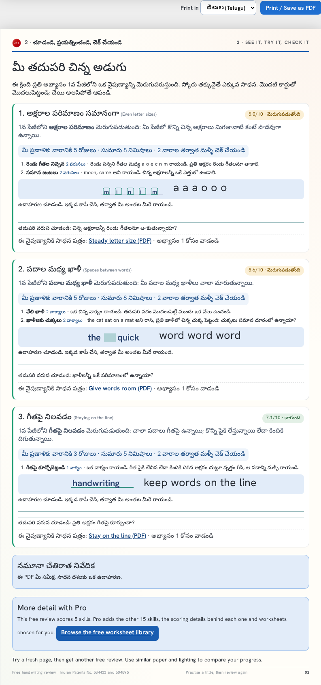

# Practice framework: exercises by factor, practice by score, report in the parent's language

Design for owner review, 2026-10-11. Nothing here changes a report until the
owner approves the mock-ups below (report format baseline,
[AI-REPORT-CONTRACT.md](AI-REPORT-CONTRACT.md)).

## 1. The problem

Feedback on the Free report:

- Page 1 says which skills are "Developing" or "Need support". Page 2 ("Your
  next small step") gives an exercise per card, but never says which skill it
  develops, what that skill scored, or why it was chosen.
- Every skill has exactly one exercise, hard-coded in
  `frontend/src/report/report-render.js` (`simpleDrills`), so a second check
  prints the same drill again.
- Every card says "do one row a day", whatever the score: a 3/10 and an 8/10
  get the same amount.
- The report is English only. A parent who reads only Telugu cannot use it,
  even when a volunteer who reads English ran the check for them.

| Today (stage, Free sample) | Proposed, Free | Proposed, printed in Telugu (draft wording) |
|---|---|---|
|  |  |  |

## 2. Development areas: one node per skill, everything connected

Each factor is a **development area**. Everything the report says about that
skill hangs off the same node, so a weak loop score always brings loop
exercises and loop tips, never a generic drill:

```
development area (factor 3, loop closure)
├── meaning        "Round letters such as a, d and o are closed."
├── evidence       why it was flagged on THIS page (existing explanations, crops)
├── exercises[]    ordered by level: close the circle, gap hunt, tall loops
├── tips[]         short hacks: "close the door", "go back over the top of a and d"
├── worksheet      the printable that goes with it (letter-shapes)
└── i18n           the same, per language
```

The framework is agnostic in four ways:

- **Renderer:** the Free and Pro reports, the website's factor pages, the
  practice guide and the Android app all read the same nodes.
- **Language:** text is looked up by id per language (section 7).
- **Tier:** a policy table, not the code, decides how much each tier shows.
- **Measurement:** a node does not care whether its score came from a photo
  or the pen; `needs` filters what a report can offer.

Tier policy (the catalogue's `tiers`; no prices, only what each report shows):

| Tier | Exercises per priority skill | Tips per priority skill | Skills scored |
|---|---|---|---|
| Free | 1 | 1 | 5 |
| Pro | up to 2 (the band decides) | 2 | all photo-scored |

The full report's `coach_tips.py` keeps its cross-skill tips (style,
finishing letters, the labelled "fun" cards); a coach tip that belongs to one
skill moves into that skill's `tips`, so the two never repeat each other.

## 3. The exercise catalogue

One catalogue, owned by this repository, maps every factor to an ordered list
of exercises. Draft content for all 20 factors:
[practice-framework/practice-catalog.draft.json](practice-framework/practice-catalog.draft.json).

Each exercise:

| Field | Meaning |
|---|---|
| `id` | Stable, `<skill>.<name>`, never reused. Reports and events name exercises by id. |
| `level` | 1 is the first to try; higher levels come once the earlier ones are done. |
| `title` | Two or three words, shown in bold. |
| `steps` | One or two plain sentences, at most about 120 characters, for a child or a parent to follow. |
| `example` | What to write, shown in the handwriting face (empty when the exercise is about the page). |
| `check` | One self-check question, asked after the practice. |
| `unit`, `base` | The amount at the "good" band: `base` rows, words, sentences, lines, letters or pages. |
| `script` | `any`, or `latin` when it only makes sense for the Latin alphabet (joined writing, a-o pairs). |
| `needs` | `photo` (scored from a photo today) or `pen` (factors 13 to 16, scored by the pen; never chosen from a photo report). |
| `worksheet` | Optional worksheet id from the website catalogue, the printable that goes with it. |
| `i18n` | Per language: `title`, `steps`, `check` (and `example` where the example is not Latin). Section 7. |

Each tip: `id` and `text` (one sentence, a hack the child can remember), plus `i18n`.

Composite factors (18 legibility, 20 neatness) carry their own exercises
but are chosen only when no single factor explains the low score, as today.

## 4. Practice by score

The band of the factor's score (the catalogue's `bands`: strong from 8.5,
good from 7, developing from 4.5, needs support below) sets how much:

| Band | Days a week | Minutes | Exercises (before the tier cap) | Amount | Check again |
|---|---|---|---|---|---|
| Needs support | every day | about 10 | 2 | base × 3 | in 2 weeks |
| Developing | 5 | about 8 | 2 | base × 2 | in 2 weeks |
| Good | 3 | about 5 | 1 | base × 1 | in 2 weeks |
| Strong | once a week, to keep it | about 3 | 1 | base × 1 | in 4 weeks |

Two limits keep it child-sized: the minutes of all cards together stay under
`daily_cap_minutes` (20); past it, the later cards drop to one exercise. The
first card is always done first ("Do the first card first").

## 5. Choosing exercises and tips

1. Priorities are chosen as today (up to three; a spelling finding may take
   one slot; lowest measured non-composite factors below 8.5).
2. For each priority, take min(band exercises, tier `exercises_max`)
   exercises in `level` order, and the tier's number of tips in list order,
   skipping `needs: pen` on a photo report and `script: latin` when the page
   is in another script.
3. A re-check moves on: the browser already keeps the last check (scores and
   date, `history`); it will also keep the exercise ids printed last time, so
   the next report starts after them and comes back to level 1 when the list
   runs out. Nothing about it leaves the browser.

## 6. What a practice card says

In this order, all from the catalogue:

1. Number, skill name, and the score with its band ("5.0/10 · Developing").
2. "Develops <skill> from page 1:" plus what was seen on this page (the
   existing explanation for that factor).
3. "Your plan: 5 days a week · about 8 minutes · check again in 2 weeks".
4. The exercises: title, amount ("2 rows"), steps.
5. The tips, marked "Tip:".
6. The example strip and writing lines (as today).
7. The self-check question, and the worksheet line, now "use it for
   exercise 1" instead of "one row a day".

The Pro report uses the same cards. Print fit: page 2 must still print on one
A4 sheet; `report-layout` gains a check for the longest case (three cards,
two exercises each, in the longest translation).

## 7. Print in the parent's language

Many parents who need this most do not read English. The planned drives work
like this: a volunteer who reads English runs the check with the family,
then prints or saves the report **in the family's language**.

- A "Print in" dropdown sits next to Print / Save as PDF: English, then
  తెలుగు (Telugu) first, then other languages as their translations are
  reviewed (Hindi, Tamil, Kannada, Malayalam). Choosing one re-renders both
  pages in that language; scores, crops and the page photo do not change.
- Every sentence in the report comes from string tables keyed by id
  (`report-strings/<lang>.json`) and from the catalogue's `i18n`. A
  missing translation falls back to English for that sentence only, and a
  test lists what is missing.
- Fonts: Noto Sans Telugu (OFL) and the other Noto faces are bundled with the
  analyser frontend, so a printed or saved PDF shows the script correctly
  on any device.
- Translations are written and checked by a native speaker before a
  language appears in the dropdown. Machine translation may draft, never
  ship unchecked. Factor names keep a short English term in brackets on
  first use so a teacher and a parent can talk about the same thing.
- The spelling note stays honest: in another language it says the check
  covered English words only.
- The anonymous `report_printed` event gains the language code, so the
  Friday report shows which languages families print in. Nothing else.
- Later, not in this change: the analyser page itself in Telugu, for
  families who run the check on their own.

## 8. Who owns what

| Piece | Where | Notes |
|---|---|---|
| Catalogue data | `backend/practice_catalog.py`, validated at import | Draft JSON here becomes this module |
| Served to clients | the versioned factor catalogue (`/api/v2/catalog/<version>`): `factors[n].exercises`, `practice.dosage` | Schema change in `backend/schemas/catalog.schema.json`; the version hash changes, clients refetch |
| Report rendering | `frontend/src/report/report-render.js` reads the catalogue; `simpleDrills` is removed | Same cards for Free and Pro |
| String tables | `frontend/src/report/strings/<lang>.json` | English is the source |
| vahini-web | factor pages show "How to practise" from the same catalogue (`tools/gen-factor-pages.mjs --sync`); Bheema's practice plan can use it later | One source, so a page never promises an exercise the report does not have |
| Android app | reads the same catalogue | No API change needed |

## 9. Tests

- Catalogue: every photo-scored factor has at least two exercises; ids
  unique and stable; every `worksheet` exists in the worksheet catalogue;
  dosage covers every band; every factor has at least two tips; the tier
  table covers free and pro; steps within the length limit; no em dashes.
- Report: each card names its factor, score, band and plan; the exercise
  count follows the band and the tier, the tips follow the tier, and every
  exercise and tip shown belongs to that card's factor; the daily cap holds; a re-check starts
  after last time's exercises.
- Print: one A4 sheet per page in English and in Telugu, longest case;
  Telugu glyphs render (no boxes) in the saved PDF.
- i18n: every key in English exists in each listed language, or is reported.

## 10. Rollout

1. Owner approves this design and the mock-ups.
2. Analyser PR: catalogue module, schema, renderer, tests (English only).
3. Analyser PR: string tables, Telugu translation reviewed by a native
   speaker, fonts, "Print in" dropdown.
4. vahini-web: pin bump; factor pages gain "How to practise".
