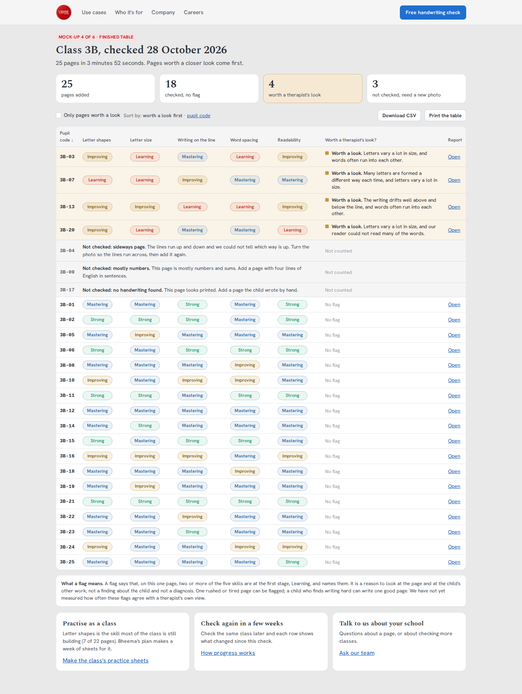

# Class screening: mock-ups for owner review

**Status: proposal. Nothing here is built, and the report does not change.**
These are HTML mock-ups and screenshots of one new flow on the analyser page,
the capacity arithmetic behind it, and the decisions that are the owner's.

## Why

A school therapist in a US district printed a report on 27 October 2026 and
said the free report was enough for one child. What districts pay for is
screening: a whole class at once, to decide which children a therapist
should look at. Today the analyser checks one page at a time, and the free
allowance is three a day per address, so a class cannot be done.

The idea: a teacher or school therapist adds one page per child, each named
by a pupil code, and gets one table back with each child's five skills and a
plain note on any page worth a therapist's look, with the reason in words.

## The six screens

Each screen is an HTML file here, shown at desktop (1440 px) and phone
(390 px) width. Phone screenshots stop at three screens; the rest repeats.

| Screen | Desktop | Phone |
|---|---|---|
| 1. Picking files: codes from file names, warnings for a name, a missing code, a duplicate, a file over 10 MB; the time estimate before starting | [01-pick-desktop.png](screens/01-pick-desktop.png) | [01-pick-phone.png](screens/01-pick-phone.png) |
| 2. Queued and running: one square per page, rows arriving one by one, time left, pause | [02-running-desktop.png](screens/02-running-desktop.png) | [02-running-phone.png](screens/02-running-phone.png) |
| 3. Partly done: back after closing the tab, two ways to resume (decision 2) | [03-resume-desktop.png](screens/03-resume-desktop.png) | [03-resume-phone.png](screens/03-resume-phone.png) |
| 4. Finished table: pages worth a look first, the meaning of a flag, next steps | [04-finished-desktop.png](screens/04-finished-desktop.png) | [04-finished-phone.png](screens/04-finished-phone.png) |
| 5. Pages refused (sideways, mostly numbers, printed) and the waits a teacher may see (busy, server restarted) | [05-refused-desktop.png](screens/05-refused-desktop.png) | [05-refused-phone.png](screens/05-refused-phone.png) |
| 6. Export: a landscape A4 print, and a CSV | [06-export-desktop.png](screens/06-export-desktop.png) | [06-export-phone.png](screens/06-export-phone.png) |



What the screens keep from the current page and rules:

- It is the analyser page with a "One page / A whole class" switch under
  "I am". The child's own report is unchanged; "Open" on a row shows that
  report as it is today.
- The five columns are the Free skills (`FREE_FACTORS` 1, 5, 7, 8, 18, under
  the names the check page already uses), shown as stage words in the
  report's band colours. No score numbers, as on the report since 23 October.
- Refusals use the analyser's own reasons (`server/app.py`), shortened. A
  refused page is not counted and has no flag.
- Every colour, font and space is a `vahini.css` token, except the four band
  colours, which are the report's own (`frontend/styles/report.css`).
- Pupil codes only. A file name that looks like a name is caught before the
  check starts (the mock-up uses "Tara", a name from our cast).

## The flag

Draft rule: a page is flagged when **two or more of the five skills are at
the first stage, Learning** (below 4.5). The reason names the first two in
plain words:

| Skill at Learning | Words in the reason |
|---|---|
| Letter shapes | many letters are formed a different way each time |
| Letter size | letters vary a lot in size |
| Writing on the line | the writing drifts well above and below the line |
| Word spacing | words often run into each other |
| Readability | our reader could not read many of the words |

So a row reads: "**Worth a look.** Letters vary a lot in size, and words
often run into each other." Never "dysgraphia", "disorder", "delay",
"deficit", "at risk", "red flag" or "fails". Under the table, every time:
the flag describes one page, not the child; a tired page can be flagged and
a child who finds writing hard can write one good page; and we have not yet
measured how often the flags agree with a therapist. #325 sets up exactly
that measurement (agreement on 100 consented pages, sensitivity and
specificity at several thresholds); its result should set the rule.

## Capacity arithmetic

### What the server allows today

| Fact | Number | Where it comes from |
|---|---|---|
| Scans at once | 1 running, 4 waiting, then 503 with `Retry-After: 20` | `/ocr/health` on production and stage, 28 Oct 2026: `VAHINI_MAX_ACTIVE_SCANS=1`, `VAHINI_MAX_QUEUED_SCANS=4`, 2,500 MB limit, 4 cores |
| What the memory alone would allow | 1 slot | `capacity.plan(2500, 4, 0)`: (2500 x 0.9 - 1200 + 200) // 800 = 1 |
| One scan's peak | about 1.6 GB | `capacity.py`, kernel `memory.peak` on stage |
| One page, sample photo | 3.1 s alone; 19 to 20 pages a minute back to back | stage load test, 7 Oct ([13-api-and-capacity.md](../13-api-and-capacity.md)) |
| One page, visitors' real photos | 7.4 s median, 10.1 s slow | production `/health` `stage_timings` on 28 Oct, sum of the stage p50s and p95s. Only 2 scans since the last restart, so indicative |
| Requests per page | 1 (`POST /api/v2/reports`) | `frontend/src/engine/ocr.js` |
| Upload per page | about 1 s | estimate: the page sends a JPEG of at most 2,600 px (0.5 to 1.5 MB) over a school line of about 10 Mbit/s. Not measured |

Planning figure: **about 9 s a page** (8 s to check, 1 s to upload).

### How long a class of 25 takes now

| Case | Arithmetic | Time |
|---|---|---|
| Quiet server, typical photos | 25 x 9 s | 3 min 45 s, shown as "about 4 minutes" |
| Neat, clear photos like the sample | 25 x 4 s | about 1 min 40 s |
| Slow photos (p95) | 25 x 11 s | about 4 min 35 s |
| Busy: families checking single pages in between | each one adds about 8 s | "up to 6 minutes" covers about 15 family checks during the class |

At today's traffic (about 10 visitors a day) the busy case does not arise.
At the growth plan's 1,000 a day, if one in ten checks a page and a busy hour
holds 15% of them, that hour has about 15 checks, two minutes of scanning:
the "up to 6 minutes" line still holds for one class.

One slot checks about 450 pages an hour, so a school day could take about
100 classes if nothing else ran. The limit is not the day, it is fairness at
the moment several classes run.

### Why the page sends one page at a time

- Sending all 25 at once: 5 are taken (1 running, 4 waiting) and 20 get 503
  at once. While four class pages sit in the queue, every family waits about
  32 s, and a family that arrives when all 5 places are used is told the
  analyser is busy.
- One page in flight: a family waits behind the class for at most one page,
  about 8 s. The class gives way between pages, which is what screen 2 says.
- Several classes at once: k classes, each with one page in flight, make
  each class k times slower and a family wait up to k x 8 s. Five classes
  fill every place and families are refused. Before more than one school
  uses it, the server should cap class pages at 2 of the 5 places (a small
  change in `scan_slots`, decision 5). Until then the page can hold back while
  `/ocr/health` shows 2 or more waiting, which is good manners but not a
  guarantee.

Memory does not change: the class flow adds no scan work, only order. Each
scan still peaks at about 1.6 GB inside the 2.5 GB limit, which stays.

### What would make it faster

1. **A second slot on this server.** `capacity.plan` gives 2 slots from a
   2,900 MB limit, so 3,000 MB and `VAHINI_MAX_ACTIVE_SCANS=2` in the
   vahini-web compose files. OCR takes 3.0 s on 2 threads against 2.7 s on 4,
   so two slots do about 1.8 times the pages a minute: **25 pages in about 2
   minutes**. It needs about 0.5 GB more free memory on a shared host that
   had about 1.9 GB free on 7 October, and a load test on stage
   (`backend/tools/load_test.py`) before production. The limit is raised,
   never removed.
2. **Room for it:** the stage analyser holds 2.5 GB all day. Stopping it
   when no one is testing would free that memory. An operations choice.
3. **A separate machine for class checks.** `capacity.plan(16000, 8, 0)` gives
   4 slots (CPU-bound): **25 pages in about a minute**, and families on the
   main server never wait behind a class. Photos still pass through and are
   not stored. Cost and hosting are the owner's; GPU numbers are not measured
   (#97).
4. **Less sharing of the CPU.** On production the `detect` stage took 4.2 s
   of wall time for 1.6 s of CPU, which suggests the scan spends more than
   half its time waiting for cores the box's other sites are using. A less
   crowded machine likely helps more than any code change. This is a reading
   of two scans, not a measurement.
5. **Not proposed: a lighter "class" scan.** Same photo, same score (#112,
   #299): a child's row in the class table and the same page checked alone
   must agree.

## What is kept, and where

- **Our server:** the same as a single check today. The photo is checked
  and not stored. The analyser's anonymous score record (`report_store.py`:
  day, scores, no name or file name) is written per page as for any check.
  The pupil code and the class name are never sent.
- **The teacher's browser:** the class name, the pupil codes and each row's
  stages and flag, until the teacher clears the class (proposed: cleared by
  itself 30 days after the last check, decision 10). In option A of screen 3
  also the photos not yet checked, each removed as soon as it is checked.
- **The export:** made in the browser. The CSV and the printed sheet carry
  codes, never names. CSV cells that start with `=`, `+`, `-` or `@` get a
  leading apostrophe so a spreadsheet does not run them as formulas.

## Open decisions for the owner

1. **Who can use it.** At three free checks a day per address, a class needs
   a key. Proposed: a school key we issue to pilot schools, which is never
   limited, as Pro keys are today. No prices on the page.
2. **Resuming after the tab closes** (screen 3). A: the unchecked photos wait
   in the teacher's browser storage, so Continue is one click. B: only the
   results are kept, and the teacher picks the same folder again; the page
   skips the codes already done. Proposed: B first, because no photo is left
   at rest anywhere, even on a shared school computer. A later if teachers
   ask.
3. **The flag rule.** Two or more skills at Learning, as drafted, or a
   threshold set from #325's results. Should a page with all five at
   Improving (3B-16 in the mock-up) be flagged? Launch with the "not yet
   measured" note, or wait for #325?
4. **Stage words or numbers** in the table and CSV. Proposed: stage words,
   as on the report since 23 October. Therapists may ask for numbers.
5. **A cap on class pages in the server queue** (2 of 5 places), needed
   before two schools run classes at the same time. A small analyser change.
6. **Capacity.** Leave it at one slot (4 minutes a class), raise to two
   slots at 3 GB after a stage load test (2 minutes), or a separate machine
   for schools (1 minute).
7. **Where it lives and what it is called.** A switch on the analyser page,
   as drawn, or its own page. The "I am" option reads "Teacher or therapist"
   in the mock-up; today it reads "Teacher".
8. **"Open" on a row.** Keeping each child's full report in the browser lets
   the teacher open it later, but that report holds the words read from the
   child's page. The alternative is the table only, with a single check for
   any page the therapist wants in full.
9. **A class scanned as one PDF** on the school copier: split it page by page
   in order and ask for the codes after. Drawn as a line on screen 1, not
   designed.
10. **How long a finished class stays in the browser:** 30 days proposed.
11. **The consent line** before the check starts ("the school has agreed")
    needs to match the schools privacy draft being written alongside.

## If approved: what building it means

- Version 1 is page work in `frontend/`: a runner that sends one page at a
  time to `POST /api/v2/reports` with the school key, follows
  `Retry-After` on 503, retries a lost page once on the same path, keeps
  results in the browser and makes the CSV and print sheet there. No new
  endpoint and no contract change.
- Server work only for decision 5 (class pages capped in `scan_slots`) and
  decision 6 (a second slot, through the vahini-web compose files).
- Tests: the runner never has more than one page in flight; a refusal is not
  counted; the CSV escapes formula cells; no pupil code or class name is in
  any request; the phone layout keeps every column.

## Viewing and regenerating

The pages load the website theme from `/site/`, as `analyser.html` does.
To render them:

```bash
docker run --rm --network host --user "$(id -u):$(id -g)" -e HOME=/tmp \
  -v "$PWD":/w -v <vahini-web checkout>/site:/site:ro -e SITE_DIR=/site -w /w \
  mcr.microsoft.com/playwright:v1.64.1-noble \
  sh -c "npm i --no-save playwright@1.64.1 && node docs/class-screening/screenshots.mjs"
```

The results in the mock-ups are made up (`mock-data.js`); they say nothing
about the analyser.
